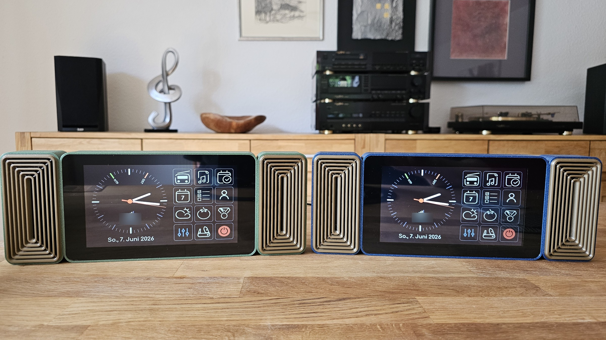
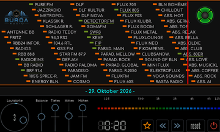
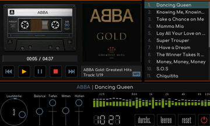
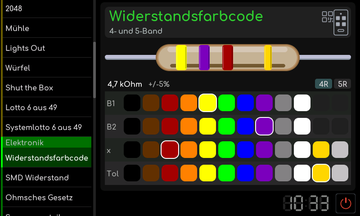

# RetroRadio

[Dokumentation](#dokumentation) | [Aufbau](docs/Aufbau.md) | [Erstinstallation](docs/RetroRadio-Ersteinrichtung.md) | [Bedienung](docs/Bedienung.md) | [Werkstatt](docs/werkstatt/README.md)

Ein selbst gebautes Internetradio mit dem Aussehen eines klassischen Tischradios und einem 7-Zoll-Touchdisplay. Analogskala, magisches Auge und Musik von der SD-Karte treffen auf Wetter, Kalender und einen Werkzeugkasten mit 38 kleinen Helfern.

RetroRadio läuft auf dem Waveshare ESP32-S3-Touch-LCD-7 mit 800 x 480 Pixeln. Die Oberfläche wird direkt am Gerät bedient. Ein gedrucktes Gehäuse mit eingebauten Stereo-Lautsprechern macht aus der Displayplatine ein eigenständiges Tischgerät. Für den Anschluss an eine vorhandene Anlage steht zusätzlich ein Stereo-Line-Out zur Verfügung.

## Dokumentation

| Thema | Anleitung |
| --- | --- |
| Nachbauen | [Bauteile](docs/Bauteile.md), [Aufbau](docs/Aufbau.md), [Fotogalerie](docs/Fotogalerie.md) |
| Drucken und bearbeiten | [3MF-Projekte und STEP-Dateien](docs/hardware/README.md) |
| Installieren | [Windows, Linux und macOS mit VS Code/PlatformIO](docs/RetroRadio-Ersteinrichtung.md), [PDF herunterladen](docs/RetroRadio-Ersteinrichtung.pdf) |
| Benutzen | [Gerätebedienung](docs/Bedienung.md), [Radio und SD-Player](docs/Radio-und-Musik.md), [Weboberfläche](docs/Weboberfläche.md) |
| Werkzeuge | [Alle 38 Werkzeuge mit Bildern](docs/werkstatt/README.md) |
| Externe Dienste | [Google und Flugradar](docs/dienste/README.md), [Datenquellen](docs/Datenquellen.md) |
| Entwickeln und Fehler finden | [Projektaufbau](docs/Projektaufbau.md), [Fehlerhilfe](docs/Fehlerhilfe.md) |

Die Anleitungen und Kommentare sind deutsch. Kleine Vorschaubilder öffnen die vollständigen Abbildungen. Die Dokumentation liegt direkt im Repository und ist mit dem jeweiligen Quellstand verfügbar.

## Wie aus einem Radio mehr wurde

Ursprünglich wollte ich nur ein einfaches Internetradio bauen. Zuvor hatte ich viel mit den leistungsfähigen Teensy-4.x-Boards gearbeitet. Nun reizte es mich, die Möglichkeiten des ESP32-S3 auszuloten, besonders bei den Visualisierungen. Dabei zeigte sich, dass dieser Controller mehr kann, als ich zunächst erwartet hatte.

Mit den zusätzlichen Anwendungen kam eine weitere Frage hinzu: Wie viele Module passen eigentlich in 8 MB Flash? Inzwischen ist aus dem Radio ein vielseitiges Tischgerät geworden. Auf meiner Variante mit 8 MB Flash und 8 MB PSRAM ist der Flash nach bisherigem Stand trotzdem erst ungefähr zur Hälfte belegt. Die ebenfalls unterstützte Variante mit 16 MB Flash und 8 MB PSRAM bietet noch mehr Platz für weitere Ideen.

Eine besondere Herausforderung waren die wenigen noch freien Ein- und Ausgänge der Displayplatine. Sie mussten so aufgeteilt und genutzt werden, dass der gesamte Aufbau damit auskommt.

## Radio und Musik

Das Internetradio zeigt die Sender auf einer nachgebildeten Analogskala mit beweglichem Zeiger. Senderspeicher erleichtern die Auswahl der Lieblingssender. Verschiedene magische Augen und Visualisierungen begleiten die Wiedergabe. Lautstärke, Balance und Klang lassen sich am Gerät einstellen.

Der SD-Player spielt Musik von der eingelegten Karte. Ordnerauswahl, Playlist, Coveranzeige und die Kassettenansicht gehören zur Bedienoberfläche. Die Lautsprecher können in den Klangeinstellungen abgeschaltet werden, der Line-Out bleibt dabei aktiv.

Über die Weboberfläche im lokalen Netzwerk lassen sich das Radio bedienen, Sender pflegen und Einstellungen bearbeiten. Zur Dateiübertragung auf die SD-Karte steht auch FTP zur Verfügung.

| Radio | SD-Player | Werkstatt |
| --- | --- | --- |
|  |  |  |

## Mehr als ein Radio

| Anwendung | Wofür Du sie nutzen kannst |
| --- | --- |
| Tagesansicht | Uhrzeit, Wetter, Termine und Wiedergabe im Überblick. |
| Kalender | Termine und Monatsansicht. |
| Aufgaben | Deine Aufgabenliste. |
| Kontakte | Adressbuch mit Suche und Detailansicht. |
| Wetter | Wettervorhersage für den eingestellten Ort. |
| Auszeit | Geführte Atem- und Lockerungsübungen. |
| Pomodoro | Arbeitsabschnitte und Pausen mit einem Kurzzeitmesser strukturieren. |
| Einstellungen | WLAN, Zeit, Klang, Anzeige, Dienste und System einrichten. |

Für Internetradio und den Abruf externer Daten wird eine WLAN-Verbindung benötigt. Die verwendeten Dienste werden in den Einstellungen eingerichtet.

## Der Werkzeugkasten

Die Werkstatt enthält 38 Werkzeuge in sieben Kategorien. Dazu gehören Rechner, Nachschlagewerke, Spiele und Helfer für Musik und Handarbeit.

| Kategorie | Beispiele |
| --- | --- |
| Werkzeuge | Taschenrechner, Weltzeit, Flugradar, Farbumrechnung, Periodensystem, Schraubenreferenz und BMI-Rechner. |
| Spiele | 2048, Mühle, Lights Out, Würfel, Shut the Box sowie Lotto und Lotto-System. |
| Elektronik | Widerstands- und SMD-Codes, Ohm-Rechner, Spannungsteiler, LED-Vorwiderstand, Filter, UKW-Resonator, LM317, Dezibel, NE555 und Operationsverstärker. |
| Einheiten | Zoll und Millimeter, Temperatur, Druck und SI-Vorsätze. |
| Digital | ASCII-Tabelle, Bit-Editor und Logikgatter. |
| Stricken | Maschenprobe, Maschenverteilung und Ärmelabnahme. |
| Musik | Quintenzirkel und Metronom. |

## Hardware

Die aktuelle Aufbauversion verwendet:

- Ein Waveshare ESP32-S3-Touch-LCD-7 mit 8 oder 16 MB Flash.
- Zwei Adafruit-MAX98357A-Verstärkermodule mit zwei Visaton BF 37 / 4 Ohm.
- Einen Adafruit PCM5102 für den analogen Stereo-Line-Out.
- Eine RTC mit DS1307 und CR2032.
- Eine Schaltung zum Abschalten der beiden Lautsprecher.
- Ein Gehäuse, Lautsprechereinsätze und Baugruppenträger aus dem 3D-Drucker.
- Eine MicroSD-Karte für die Musikwiedergabe von der Karte.

Die Nachbauanleitung beschreibt die Aufbauversion Rev.2. Die frühere Rev.1 verwendet andere Lautsprecher und wird als Vorgängervariante gezeigt. Von vorn sehen beide Versionen gleich aus. Die Aufbauversion ist unabhängig davon, ob das Displayboard 8 oder 16 MB Flash besitzt.

Meine Geräte laufen am Schreibtisch bei moderater Lautstärke an den USB-Buchsen der Rechner. Als separates Netzteil empfehle ich das offizielle Raspberry-Pi-USB-C-Netzteil mit 5,1 V / 3,0 A, erhältlich in Schwarz oder Weiß.

Die Verdrahtung ist als [Gesamtübersicht](docs/hardware/pläne/RetroRadio-Verdrahtungsplan-1.png) und [Detailseite](docs/hardware/pläne/RetroRadio-Verdrahtungsplan-2.png) dargestellt. Beide Seiten stehen zusammen als [Verdrahtungsplan im PDF-Format zum Herunterladen](docs/hardware/pläne/RetroRadio-Verdrahtungsplan.pdf) bereit.

## Nachbau und Inbetriebnahme

Das Projekt lässt sich in Visual Studio Code mit PlatformIO öffnen, bearbeiten, bauen und auf das Gerät übertragen. Für die beiden Flashgrößen stehen passende Projektumgebungen bereit:

| Flashgröße | PlatformIO-Umgebung |
| --- | --- |
| 8 MB | `waveshare_esp32s3_lcd7_8mb` |
| 16 MB | `waveshare_esp32s3_lcd7_16mb` |

Die [Anleitung zur ersten Inbetriebnahme](docs/RetroRadio-Ersteinrichtung.md) führt durch die Erstinstallation über UART1 und den anschließenden Wechsel auf USB. Beginne mit dem Displayboard ohne angeschlossene Audio-Hardware. Der UART-Umschalter und die beiden USB-Buchsen sind in der Anleitung beschrieben.

Nach dem ersten Start richtest Du WLAN, Uhrzeit und die gewünschten Dienste ein. Die Audio-Baugruppen werden entsprechend dem Anschlussplan ergänzt. Die Auswahl der Firmware richtet sich nach der Flashgröße Deines Boards.

## Lizenz und Herkunft

Der eigene RetroRadio-Quellcode steht unter der [GPL-3.0](LICENSE). Enthaltene Bibliotheken, Schriften, Symbole und Bilder haben eigene Herkunfts- und Lizenzvermerke, die Übersicht steht in [LIZENZEN.md](docs/LIZENZEN.md).

Ein besonderer Dank geht an **Frank alias Tubefan aus dem RBF (Radio-Bastler-Forum)**. Er hat die Lautsprechergitter im CAD erstellt.

Danke an Wolle alias schreibfaul1 für ESP32-audioI2S als Grundlage der modifizierten Audio-Bibliothek `audio-lite`, an N. Waldt für den EM34-Emulator sowie an die Projekte Phosphor Icons und Lucide für die verwendeten Symbole.

Die Wetter- und Ortsdaten stammen von Open-Meteo beziehungsweise OpenStreetMap und Nominatim. Die Flugdaten liefert das OpenSky Network. Die zugehörigen Hinweise und Bedingungen stehen unter [Datenquellen](docs/Datenquellen.md).

[Dokumentation](#dokumentation) | [Aufbau](docs/Aufbau.md) | [Erstinstallation](docs/RetroRadio-Ersteinrichtung.md) | [Bedienung](docs/Bedienung.md) | [Werkstatt](docs/werkstatt/README.md)
