# RetroRadio aufbauen

[RetroRadio](../README.md) > [Dokumentation](../README.md#dokumentation) > RetroRadio aufbauen

Diese Anleitung beschreibt die Rev.2 mit zwei Visaton BF 37. Die frühere Rev.1 verwendet andere Lautsprecher und passende Einsätze, sie ist in der [Fotogalerie](Fotogalerie.md) gekennzeichnet. Beide Aufbauversionen sehen von vorn gleich aus. Die Wahl zwischen 8 und 16 MB Flash betrifft die Firmwareumgebung, nicht die hier beschriebene Verdrahtung.

> Verwende das **ESP32-S3-Touch-LCD-7 mit 800 x 480 Pixeln und SKU 27078**. Das ähnlich aussehende [ESP32-S3-Touch-LCD-7B](https://docs.waveshare.com/ESP32-S3-Touch-LCD-7B) mit **1024 x 600 Pixeln** ist für RetroRadio **nicht geeignet**. Die PCB-Revisionen und ihre Speicherbestückung stehen in der [Bauteileliste](Bauteile.md#displayboard).

[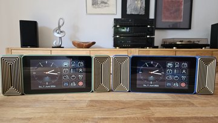](bilder/gerät/20260607_141617.jpg)

## Audio-Ausbauvarianten

DAC und Verstärkermodule müssen nicht gemeinsam eingebaut werden. Wähle die Audio-Bestückung passend zur gewünschten Ausgabe:

| Gewünschte Ausgabe | Benötigte Audio-Module |
| --- | --- |
| Nur interne Lautsprecher | Zwei Adafruit MAX98357A |
| Nur analoger Stereo-Line-Out | Ein Adafruit PCM5102 |
| Interne Lautsprecher und analoger Stereo-Line-Out | Zwei Adafruit MAX98357A und ein Adafruit PCM5102 |

Fotos, Schaltplan und die folgenden Montageschritte zeigen den Vollausbau. Führe nur die Schritte für die gewählten Audio-Zweige aus und lasse die übrigen Zweige samt ihren zugehörigen Bauteilen weg. Die [Bauteileliste](Bauteile.md#audio-ausbauvarianten) ordnet auch Lautsprecher, Abschaltung, Elkos und Ausgangsbuchse zu. Die gemeinsamen I2S-Leitungen und die Versorgung werden nur mit den tatsächlich eingebauten Audio-Modulen verbunden.

## Unterlagen und Reihenfolge

- [Bauteileliste](Bauteile.md)
- [Gehäuse, Druckprojekte, STEP-Dateien und Befestigung](hardware/README.md)
- [Verdrahtungsplan als PDF zum Herunterladen](hardware/pläne/RetroRadio-Verdrahtungsplan.pdf)
- [Alle Aufbaufotos mit anklickbaren Vorschaubildern](Fotogalerie.md)
- [Erstinstallation unter Windows, Linux und macOS](RetroRadio-Ersteinrichtung.md)

Installiere die Firmware zunächst auf dem Displayboard ohne angeschlossene Audio-Baugruppen. Dafür gelten die Buchsen und Schalterstellungen der Erstinstallationsanleitung. Prüfe danach die einzelnen Verbindungen bei ausgeschalteter Versorgung und ergänze Audio, RTC und Gehäuse. Zum normalen Betrieb steht der UART-Umschalter auf UART2, weil die betreffenden Anschlüsse für I2S verwendet werden.

| Gesamtverdrahtung | Einzelheiten |
| --- | --- |
| [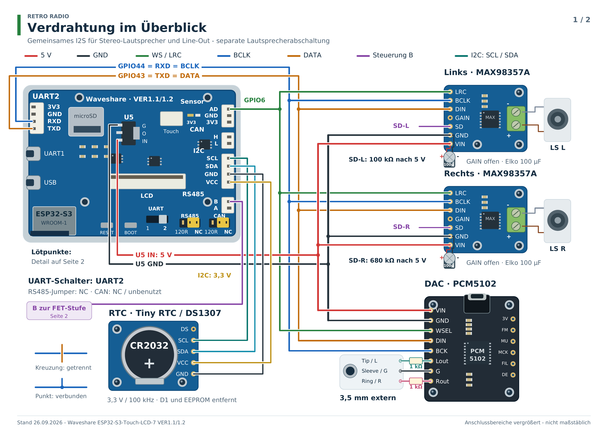](hardware/pläne/RetroRadio-Verdrahtungsplan-1.png) | [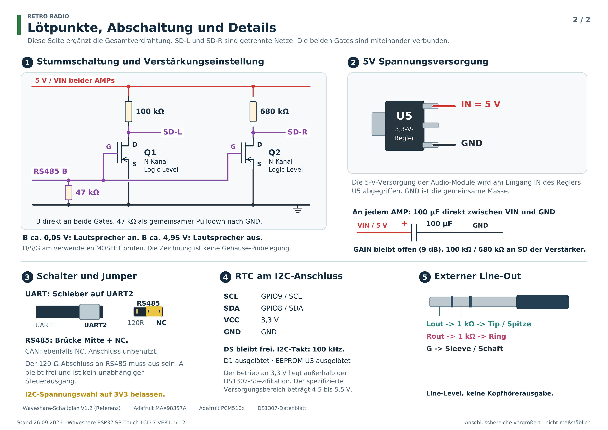](hardware/pläne/RetroRadio-Verdrahtungsplan-2.png) |

Die Zeichnung ist funktional und nicht maßstäblich. Maßgeblich sind die Signalnamen, der konkrete Platinenaufdruck und die Anschlussbelegung der verwendeten Bauteile.

## Display und Befestigungsbolzen

Das Waveshare-Display trägt die Hauptplatine auf seiner Rückseite. Die Fotos zeigen das Board, den Lieferumfang und die bearbeiteten Abstandshalter.

> **Glasrückseite: Abdeckfolie nicht abziehen.** Unter dieser Folie liegt eine Klebeschicht. Wird sie freigelegt, haftet das Display sehr fest im Gehäuse und lässt sich später nur mit größter Sorgfalt wieder herauslösen. **Die beiden Befestigungsschrauben reichen für einen sicheren Halt aus.** Lass die Abdeckfolie auf der Glasrückseite und schneide nur ihre überstehende Abziehlasche ab.

**Vorderseite: beide Schutzfolien entfernen.** Unter der äußeren Transportschutzfolie liegt eine zweite, dünne Schutzfolie, ähnlich einer Smartphone-Schutzfolie. Diese zusätzliche Folie verkratzt sehr leicht, das Displayglas selbst ist deutlich kratzfester. Entferne daher beide Folien von der Vorderseite.

| Displayeinheit | Mitgelieferte Teile | Befestigungsbolzen |
| --- | --- | --- |
| [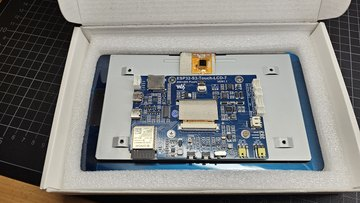](bilder/aufbau/20260529_212225.jpg) | [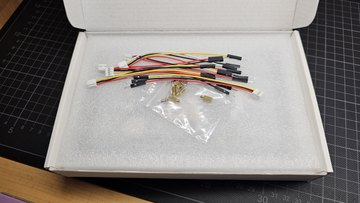](bilder/aufbau/20260529_212209.jpg) | [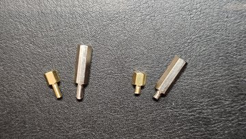](bilder/aufbau/20261028_213523.jpg) |

Benötigt werden vier Bolzen mit M2,5-Gewinde und **4 mm langem Körper** sowie zwei Bolzen mit M3-Gewinde und **15 mm langem Körper**. Die kurzen Bolzen halten die Grundplatte für die Baugruppen. Die beiden 15-mm-M3-Bolzen sitzen diagonal am Display an den in den STEP-/Druckdateien vorgesehenen Punkten. Die unterschiedlichen Befestigungen sind an der Konstruktion zuzuordnen.

> **Nur die Außengewinde kürzen.** Die Bolzenkörper selbst bleiben 4 mm beziehungsweise 15 mm lang. Links im Foto liegen die Ausgangsteile, rechts die Teile mit gekürzten Gewinden. Zu weit eingeschraubte Gewinde können das Display beschädigen. Prüfe vor dem Einschrauben die verfügbare Tiefe und kürze die Außengewinde passend zur jeweiligen Befestigung.

## Gehäuse und Lautsprecher

Drucke Gehäuse, Abdeckung, Grundplatte, Aufsteller und die zum Lautsprecher passenden Einsätze aus den [bereitgestellten Projekten](hardware/README.md). Die Rev.2 verwendet **Visaton BF 37 mit 4 Ohm**. Für die frühere Rev.1 ist der Einsatz für **Visaton SC 4.9 FL mit 8 Ohm** enthalten.

Klebe die Lautsprechereinsätze mit UV-Resin in das Gehäuse und härte die Klebenähte aus. Achte beim Einpassen auf die Ausrichtung der Lautsprecher und die spätere Leitungsführung.

| Einsätze BF 37 | Verklebung | Lautsprecher | Einbau |
| --- | --- | --- | --- |
| [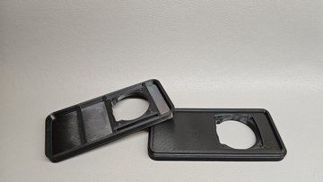](bilder/aufbau/20260822_135305.jpg) | [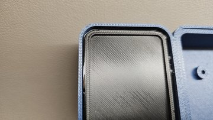](bilder/aufbau/20260822_141135.jpg) |  | [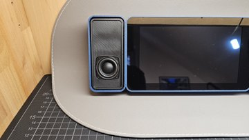](bilder/aufbau/20260822_193828.jpg) |

## Baugruppen auf der Grundplatte

Im gezeigten Vollausbau sitzen auf der Grundplatte ein PCM5102-DAC, zwei MAX98357A-Verstärker und die RTC. Die kleinen selbstschneidenden Schrauben heißen im verwendeten Sortiment **M2*5**, sie sind keine metrischen M2-Maschinenschrauben. Die übrigen Schrauben sind M2,5 und M3. Wähle ihre Länge passend zur verfügbaren Einschraubtiefe. Die vollständigen Sortimentsbezeichnungen und Druckdateien stehen in der [Hardwareübersicht](hardware/README.md).

[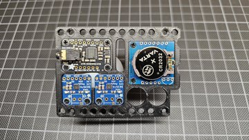](bilder/aufbau/20260923_120917.jpg)

## Mechanische Endmontage

1. Lautsprechereinsätze einpassen und verkleben, danach die Lautsprecher in ihren Einsätzen befestigen. Die Lautsprecherabdeckung am Gehäuse montieren.
2. Die Außengewinde der Bolzen auf die am eigenen Display verfügbare Tiefe kürzen und entgraten. Die vier kurzen M2,5-Bolzen für die Grundplatte und die beiden langen M3-Bolzen diagonal am Display zuordnen.
3. Das Display mit aufliegender Abdeckfolie auf der Glasrückseite in das Gehäuse einsetzen und mit den beiden vorgesehenen Befestigungsschrauben sichern. Grundplatte mit den gewählten Baugruppen auf den kurzen Bolzen montieren.
4. Den Aufsteller an den vorgesehenen Gehäuseaufnahmen befestigen. Leitungen so führen, dass sie nicht an Lautsprechermembranen, Display oder Schraubspitzen anliegen. Schrauben nach Gewinde und verfügbarer Einschraubtiefe auswählen, ohne sie gegen Widerstand weiterzudrehen.
5. Für den nach hinten geführten USB-Anschluss verwendet der gezeigte Aufbau einen [UGREEN-USB-C-Winkeladapter, 90 Grad](https://www.amazon.de/dp/B0FNCT8NS7). Das zugehörige Foto zeigt die zusätzliche Abstützung aus UV-Resin. Adapter und Datenkabel vor der endgültigen Befestigung auf Sitz und Datenverbindung prüfen.

[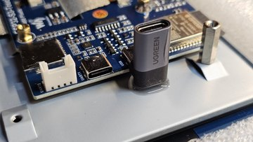](bilder/aufbau/20261001_193314.jpg)

## Gemeinsamer I2S-Anschluss

Die eingebauten Audio-Module erhalten dieselben Audiodaten und Takte. Bei bestückten Mono-Verstärkern erfolgt die Kanalwahl an den beiden Verstärkermodulen.

| Signal | Displayboard | Verstärker links | Verstärker rechts | DAC |
| --- | --- | --- | --- | --- |
| Audiodaten | UART2 TXD, GPIO43 | DIN | DIN | DIN |
| Bit-Takt | UART2 RXD, GPIO44 | BCLK | BCLK | BCK |
| Word-Select | Sensor AD, GPIO6 | LRC | LRC | WSEL |
| Masse | GND | GND | GND | GND |
| Versorgung | Eingang IN von U5, 5 V | VIN | VIN | VIN |

Der UART-Umschalter steht hierfür auf **UART2**. GPIO44 ist trotz der Beschriftung RXD ein Taktausgang. Die I2S-Signale haben 3,3-V-Pegel, die Audio-Module werden mit 5 V versorgt. Eine zusätzliche MCLK-Leitung wird nicht benutzt. Verbindungen kurz halten und die Masse aller Baugruppen verbinden.

### Versorgung und Elkos

Die 5 V werden am Eingang **IN des Reglers U5** abgegriffen. Je Verstärker sitzt ein **100-µF-/25-V-Elko** unmittelbar zwischen VIN und GND: Plus an VIN, Minus an GND. Verwechsle den 5-V-Eingang des Reglers nicht mit seinem 3,3-V-Ausgang.

| 5-V-Abgriff | Elkos | Steckverbinder |
| --- | --- | --- |
| [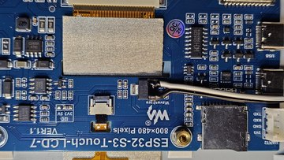](bilder/aufbau/20260923_191638.jpg) | [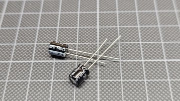](bilder/aufbau/20260923_122918.jpg) | [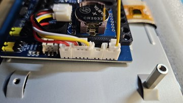](bilder/aufbau/20260924_121947.jpg) |

### Linker und rechter Verstärker

| Verstärker | Zusatzwiderstand | Verbindung | GAIN |
| --- | --- | --- | --- |
| Links | 100 kΩ | Eigener SD-Pin an VIN über den Widerstand | offen |
| Rechts | 680 kΩ | Eigener SD-Pin an VIN über den Widerstand | offen |

Die vorhandenen Board-Widerstände bleiben bestückt. Die beiden SD-Pins bleiben voneinander getrennt. Sie dürfen weder direkt an 5 V noch direkt miteinander verbunden werden. Die offenen GAIN-Pins ergeben beim verwendeten Adafruit-Modul 9 dB. Der dokumentierte Aufbau wurde mit dieser Einstellung betrieben.

Jeder Lautsprecher wird ausschließlich zwischen die beiden Lautsprecherausgänge seines Verstärkers angeschlossen. **Keinen dieser Ausgänge mit GND verbinden.**

## Lautsprecherabschaltung

Je Verstärker zieht ein N-Kanal-FET dessen SD-Pin auf GND, wenn die Lautsprecher abgeschaltet werden. Die Bilder zeigen zwei ausgeführte Varianten mit **2N7000** und **AO3400**. Prüfe die tatsächliche Anschlussfolge von Gate, Drain und Source am verwendeten Bauteil, die Gehäuse sind nicht allgemein anschlussgleich.

| Anschluss | Verbindung |
| --- | --- |
| Drain links | SD des linken Verstärkers |
| Drain rechts | SD des rechten Verstärkers |
| Beide Sources | GND |
| Beide Gates | Gemeinsamer Knoten an RS485 B / TX- |
| 47-kΩ-Widerstand | Zwischen gemeinsamem Gate-Knoten und GND |
| RS485 A / TX+ | unbenutzt |

**Den 120-Ω-Abschluss am RS485-Anschluss ausschalten.** Die 47 kΩ liegen als Pulldown an GND, nicht in Reihe zur Steuerleitung. Der RS485-Anschluss wird hier als Schaltausgang benutzt, es läuft darüber keine serielle Kommunikation.

| FET 2N7000 | Eingebaute Variante 2N7000 | Eingebaute Variante AO3400 |
| --- | --- | --- |
| [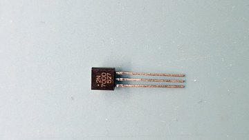](bilder/aufbau/20260923_135827.jpg) | [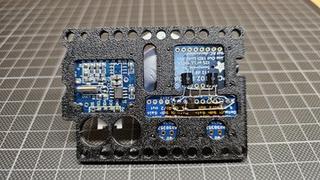](bilder/aufbau/20260923_143153.jpg) | [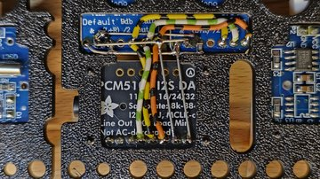](bilder/aufbau/20260929_124701.jpg) |

Die Firmware steuert GPIO16: HIGH schaltet die Lautsprecher ein, LOW schaltet sie aus. Der RS485-Treiber invertiert dabei den Pegel an B. Der DAC und der Line-Out laufen auch bei abgeschalteten Lautsprechern weiter. Die Bedienung erfolgt unter **Einstellungen -> Klang -> Lautsprecher**.

## RTC vorbereiten und anschließen

Verwendet wird ein Tiny-RTC-Modul mit DS1307, Platinenaufdruck HW-111 und einer CR2032. Im dokumentierten Aufbau sind **Diode D1 und EEPROM U3 entfernt**. D1 darf bei der verwendeten CR2032 nicht als Ladepfad bestückt bleiben.

| Bestückungsseite, D1 bereits entfernt | Batterieseite mit CR2032 | Kabelbelegung |
| --- | --- | --- |
| [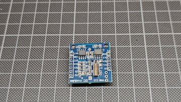](bilder/aufbau/20260923_114835.jpg) | [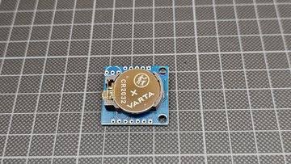](bilder/aufbau/20260923_120530.jpg) | [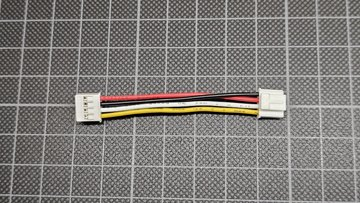](bilder/aufbau/20260530_205745.jpg) |

| Display-I2C | RTC |
| --- | --- |
| SCL, GPIO9 | SCL |
| SDA, GPIO8 | SDA |
| VCC, 3V3 | VCC |
| GND | GND |

Die Spannungswahl der Displaybuchse bleibt auf **3V3**. DS bleibt frei. Prüfe jede Ader beidseitig: Beim fotografierten Kabel müssen die Adern wie gezeigt umgesetzt werden, sonst stimmen VCC und GND nicht. Verlasse Dich nicht allein auf die Kabelfarben. Der Bus arbeitet mit 100 kHz.

Der beschriebene DS1307-Betrieb an 3,3 V liegt außerhalb seiner spezifizierten Versorgung von 4,5 bis 5,5 V. Die RTC wird nicht an die 5-V-Audioversorgung angeschlossen. Siehe [DS1307-Datenblatt](https://www.analog.com/media/en/technical-documentation/data-sheets/DS1307.pdf).

Auf dem Foto der Bestückungsseite ist D1 bereits entfernt, U3 ist noch bestückt. Entferne vor dem Einbau auch U3 und kontrolliere die Bestückungsseite.

## Stereo-Line-Out

Am Adafruit-PCM5102 wird **Lout über 1 kΩ an Tip**, **Rout über 1 kΩ an Ring** und **G direkt an Sleeve** einer Stereo-Klinkenverbindung geführt. Die [verwendete 3,5-mm-Klinkenbuchse](https://www.amazon.de/dp/B0GXCL5WSP) hat vier Kontakte, der zusätzliche Kontakt bleibt unbenutzt. Ermittle die Lötfahnen mit einem eingesteckten Stecker und einem Durchgangsprüfer. Eine universelle Zuordnung nach der äußeren Form der Buchse ist nicht möglich.

**Vorsicht beim Löten:** Der Kunststoffkörper der im gezeigten Aufbau verwendeten Klinkenbuchse ist wärmeempfindlich und kann sich schnell verformen. Verzinne die Leitungsenden vorab, erwärme die Lötfahnen nur kurz und lasse die Buchse zwischen den einzelnen Lötstellen abkühlen.

| Buchse | Verdrahtung |
| --- | --- |
| [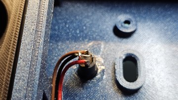](bilder/aufbau/20261007_200803.jpg) | [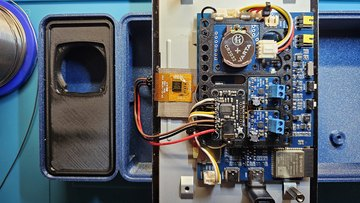](bilder/aufbau/20261007_202331.jpg) |

Der Line-Out kann einen externen Verstärker oder einen externen Bluetooth-Sender versorgen. Eine integrierte Bluetooth-Audioübertragung gehört nicht zur beschriebenen Firmware.

### Alternatives PCM5102A-Modul

Als Alternative zum Adafruit-DAC ist hier die in [MakerGuides beschriebene PCM5102A-Modulbauform](https://www.makerguides.com/de/playing-audio-with-esp32-and-pcm5102-de/) mit eigener 3,5-mm-Klinkenbuchse, 3,3-V-Spannungsreglern und den Lötbrücken H1L bis H4L beschrieben. Die Angaben beziehen sich auf diese Bauform, andere PCM5102A-Platinen können abweichen.

> **Prüfstand: noch nicht am RetroRadio erprobt.** Die Anschlussvariante wurde anhand der Modulbeschreibung und des TI-Datenblatts ausgearbeitet. Der praktische Test steht noch aus. Der fotografierte Adafruit-Aufbau ist der am Gerät erprobte Aufbau.

#### Anschluss an das Displayboard

| PCM5102A-Modul | Anschluss am RetroRadio |
| --- | --- |
| DIN | UART2 TXD, GPIO43 |
| BCK | UART2 RXD, GPIO44 |
| LRCK | Sensor AD, GPIO6 |
| GND | Gemeinsame Masse mit dem Displayboard |
| VIN | 5-V-Abgriff am Eingang IN des Reglers U5 |
| SCK | GND, über die dafür vorgesehene SCK-Brücke |

Der UART-Umschalter steht auf **UART2**. Die I2S-Leitungen haben 3,3-V-Pegel. **5 V werden ausschließlich an VIN vor den Spannungsreglern des Moduls angelegt.** DAC-Chip und H-Pegel der Funktionsbrücken arbeiten mit 3,3 V. Diese Versorgung gilt nur für die beschriebene Modulbauform mit entsprechender Regelung. Die bestehende RetroRadio-Firmware wird dafür nicht geändert.

#### Lötbrücken

Setze die Brücken bei abgeschalteter Versorgung entsprechend dem H-/L-Aufdruck der Platine:

| Brückengruppe / Funktion | Einstellung | Wirkung |
| --- | --- | --- |
| H1L / FLT | L, GND | Filter mit normaler Latenz |
| H2L / DEMP | L, GND | De-Emphasis ausgeschaltet |
| H3L / XSMT | H, 3,3 V | Audioausgang freigegeben |
| H4L / FMT | L, GND | I2S-Audioformat |
| SCK-Brücke | Schließen, SCK an GND | Betrieb ohne externen Mastertakt |

Verbinde bei H1L bis H4L jeweils den mittleren Kontakt nur mit der angegebenen Seite H oder L. Entferne eine vorhandene Verbindung zur anderen Seite zuerst. H und L dürfen nicht gleichzeitig verbunden sein. Zusätzliche Leitungen zu FLT, DEMP, XSMT und FMT sind bei dieser Brückenbestückung nicht nötig.

**SCK und BCK sind verschiedene Anschlüsse:** SCK ist der zusätzliche Mastertakteingang und bleibt auf GND, BCK erhält den Bit-Takt von GPIO44. FMT auf L wählt I2S, nicht das rechtsbündige Audioformat.

[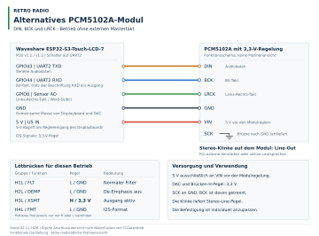](hardware/pläne/RetroRadio-PCM5102A-Alternative.png)

Die Grafik zeigt die Signalzuordnung, keine räumliche Platinenansicht. Die [bearbeitbare SVG-Grafik](hardware/pläne/RetroRadio-PCM5102A-Alternative.svg) liegt ebenfalls bei.

Die Klinkenbuchse auf dem Modul liefert bereits den analogen Stereo-Line-Out. Bei Nutzung dieser Buchse entfallen die externe Klinkenbuchse und die beiden zusätzlichen 1-kΩ-Widerstände aus dem Adafruit-Aufbau. Der Ausgang ist für einen externen Verstärker oder aktive Lautsprecher bestimmt. Passive Lautsprecher werden dort nicht direkt angeschlossen.

**Befestigung und Gehäuse:** Die vorhandene Grundplatte sowie die Druck- und CAD-Dateien sind auf die Adafruit-Module ausgelegt. Auch die beiden Gesamtverdrahtungspläne zeigen den Adafruit-Aufbau. Befestigungspunkte und gegebenenfalls der Zugang zur Modul-Klinkenbuchse müssen für die alternative Platine angepasst werden. Eine passende Druck- oder CAD-Variante liegt noch nicht bei. Hinweise zum Bearbeiten der STEP-Dateien stehen in der [Hardwareübersicht](hardware/README.md#cad-dateien-anpassen).

Quellen: [MakerGuides mit Modulschaltbild und Brückenfotos](https://www.makerguides.com/de/playing-audio-with-esp32-and-pcm5102-de/) und [TI-Datenblatt PCM5102A, Pin-Funktionen und Dreileitungsbetrieb](https://www.ti.com/lit/ds/symlink/pcm5102a.pdf).

## Abschluss und Inbetriebnahme

Prüfe bei abgeschalteter Versorgung die Polarität der Elkos, 5 V und GND, die getrennten SD-Leitungen, die FET-Anschlüsse und die RTC-Kabelbelegung. Prüfe, ob Leitungen frei von Schrauben und Gehäusekanten liegen. Schließe danach die Versorgung an und beginne mit kleiner Lautstärke. Prüfe die bestückten Audio-Ausgänge und bei eingebauten Lautsprechern auch deren Abschaltung in den Klangeinstellungen.

| Fertig verdrahtet | Bestückte Displayeinheiten | Gehäusevarianten |
| --- | --- | --- |
| [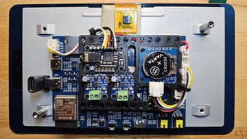](bilder/aufbau/20260925_202741.jpg) | [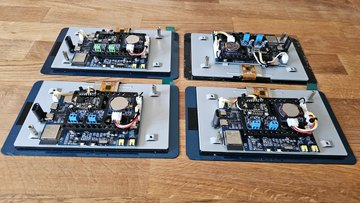](bilder/aufbau/20261003_133322.jpg) | [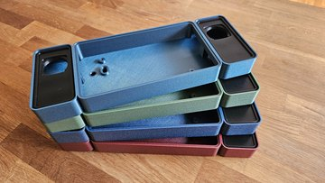](bilder/aufbau/20261003_134104.jpg) |

Bei moderater Lautstärke lassen sich die Geräte an Rechner-USB-Buchsen betreiben. Als separates Netzteil empfiehlt sich das offizielle Raspberry-Pi-USB-C-Netzteil mit **5,1 V / 3,0 A**, erhältlich in Schwarz oder Weiß. Die erreichbare Lautstärke hängt auch von der Versorgung ab. Danach helfen [Erstinstallation](RetroRadio-Ersteinrichtung.md) und [Bedienung](Bedienung.md) weiter.

## Technische Quellen

[MAX98357A-Anschlüsse von Adafruit](https://learn.adafruit.com/adafruit-max98357-i2s-class-d-mono-amp/pinouts), [PCM510x-Anschlüsse von Adafruit](https://learn.adafruit.com/adafruit-pcm510x-i2s-dac/pinouts) und [Waveshare-Schaltplan Rev.1.2](https://files.waveshare.com/wiki/ESP32-S3-Touch-LCD-7/ESP32-S3-Touch-LCD-7-Sch.pdf). Die Displayplatine auf den Fotos trägt VER1.1. Der verlinkte Waveshare-Schaltplan beschreibt Rev.1.2.

[RetroRadio](../README.md) > [Dokumentation](../README.md#dokumentation) > RetroRadio aufbauen
