# RetroRadio bedienen

Nach der [Erstinstallation](RetroRadio-Ersteinrichtung.md) öffnet das Hauptmenü die Anwendungen über die großen Symbole rechts. Die Uhr und die Netzwerkangaben stehen links. Zum Verlassen einer Anwendung dient die Taste mit dem Ein-/Aus-Symbol unten rechts. Bei Radio und SD-Player öffnet sie zunächst den Ausschalt- beziehungsweise Sleep-Timer-Dialog.

[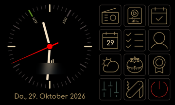](bilder/bedienung/hauptmenue.png)

| Zeile | Links | Mitte | Rechts |
| --- | --- | --- | --- |
| 1 | Internetradio | SD-Player | Tagesansicht |
| 2 | Kalender | Aufgaben | Kontakte |
| 3 | Wetter | Pomodoro / Timer | Auszeit |
| 4 | Einstellungen | Werkstatt | Ausschalten |

Ein kurzer Tipp wählt eine Taste oder ein Feld. Listen lassen sich mit dem Finger verschieben. Ein längerer Druck oder Wischen hat nur an den jeweils beschriebenen Stellen eine Zusatzfunktion. Eingabedialoge besitzen eigene Bestätigungs- und Abbruchmöglichkeiten. Beim Bearbeiten von Einstellungen auf die angezeigte Speichern-Taste achten; das Verlassen kann bei ungespeicherten Änderungen eine Rückfrage auslösen.

## Radio, SD-Player und Werkstatt

- [Radio und Musik](Radio-und-Musik.md): Sender, Favoriten, Klang, alle acht Visualisierungen, vier magische Augen, Dateiauswahl, Cover und Kassetten.
- [Werkstatt mit 38 Werkzeugen](werkstatt/README.md): nach Kategorien geordnete Übersicht mit einzelnen Werkzeugseiten und anklickbaren Vorschaubildern.
- [Weboberfläche](Weboberfläche.md): Bedienung und Verwaltung im Browser, einschließlich Senderpflege und SD-Dateien.

## Tagesansicht

Die Tagesansicht verbindet Uhr, Datum, Wetter, kommende Termine, Aufgaben und Geburtstage. Am unteren Rand liegen die Radio- und SD-Bedienelemente. Favoriten und Senderwechsel sind links angeordnet; daneben folgen die Lautstärke-Tasten und die SD-Aktionen. Die kleine Anzeige zwischen Minus und Plus zeigt die Lautstärke. Die Laufzeile darüber zeigt Nachrichten beziehungsweise Informationen zur Wiedergabe.

[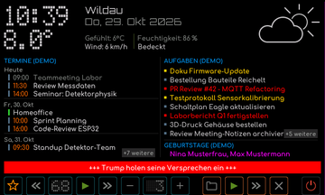](bilder/bedienung/tagesansicht-demo.png)

Radio-Favoriten öffnen die Senderauswahl. Die Pfeile wechseln den Sender; die Wiedergabetaste startet beziehungsweise unterbricht die entsprechende Audioquelle. Über das Ordnersymbol lassen sich SD-Titel auswählen. Die SD-Gruppe bietet außerdem Wiedergabe, nächsten Titel und das Leeren der Liste. Die beiden Audioquellen werden nicht gleichzeitig abgespielt.

Kalender und Aufgaben verwenden die in der [Google-Anbindung](dienste/google/README.md) gespeicherten Adressen. Ohne die jeweilige Verbindung erscheint eine als **DEMO** gekennzeichnete Auswahl. Das Wetter verwendet den eingestellten Wetterstandort. Die Abbildung zeigt eingebaute Beispieldaten; Termine, Aufgaben und Geburtstage stammen nicht aus einem persönlichen Konto.

## Kalender

Links steht die Liste der kommenden Termine, rechts stehen der aktuelle und der nächste Monat. Der heutige Tag ist hervorgehoben; Markierungen kennzeichnen Tage mit Terminen. Wische in der Terminliste, um weitere Einträge zu sehen. Ganztägige Einträge und Termine mit Uhrzeit werden unterschiedlich dargestellt.

| Übersicht | Weitere Termine |
| --- | --- |
| [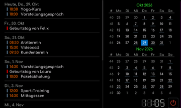](bilder/bedienung/kalender-demo.png) | [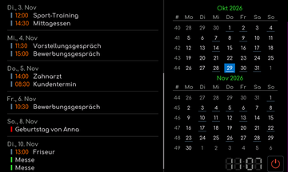](bilder/bedienung/kalender-demo-termine.png) |

Termine werden in Google Kalender gepflegt. Die Geräteansicht zeigt sie an; sie ist kein Editor zum Anlegen neuer Termine. Die zugehörige Web-App und die eingebundenen Kalender werden in der [Google-Anleitung](dienste/google/README.md) eingerichtet. Die Abbildungen zeigen die eingebauten Demotermine.

## Aufgaben

Links stehen Aufgaben nach Listen gegliedert. Die Datumsfarbe kennzeichnet unter anderem heute fällige und überfällige Einträge. Rechts zeigt die Statistik die Gesamtzahl, offene, heute fällige und überfällige Aufgaben. Der Schalter **Erledigte** blendet abgeschlossene Einträge ein oder aus. **Aktualisieren** ruft die Liste erneut ab.

| Aufgabenliste | Nur offene Aufgaben | Bestätigung |
| --- | --- | --- |
| [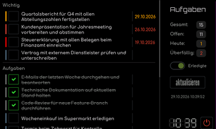](bilder/bedienung/aufgaben-demo.png) | [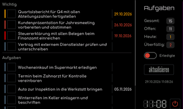](bilder/bedienung/aufgaben-demo-offene.png) | [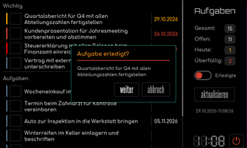](bilder/bedienung/aufgaben-demo-bestaetigung.png) |

Tippe das Kästchen vor einer Aufgabe an. Der Dialog nennt die betroffene Aufgabe und fragt vor der Änderung nach. Bei eingerichteter Google-Verbindung wird die bestätigte Änderung auch in Google Tasks übernommen. Ein erledigter Eintrag kann entsprechend wieder geöffnet werden. Im Demomodus werden keine Google-Aufgaben geändert. Neue Aufgaben und Notizen pflegst Du in Google Tasks.

## Kontakte

Die linke Liste zeigt die Kontakte. Die Buchstabenleiste springt zum jeweiligen Anfangsbuchstaben; Wischen bewegt die Liste. Ein Tipp auf einen Namen zeigt rechts Telefonnummern, E-Mail, Adresse, Organisation und Geburtstag, soweit diese Angaben vorhanden sind.

| Kontakt und Details | Suche | Suchergebnis |
| --- | --- | --- |
| [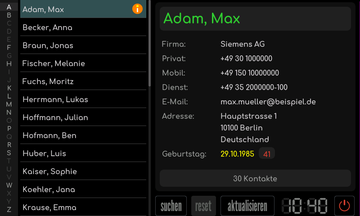](bilder/bedienung/kontakte-demo.png) | [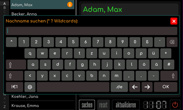](bilder/bedienung/kontakte-demo-suche.png) | [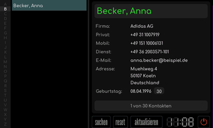](bilder/bedienung/kontakte-demo-suchergebnis.png) |

**Suchen** öffnet die Bildschirmtastatur für die Nachnamensuche. Der Dialog unterstützt die angegebenen Platzhalter **\*** und **?**. **Reset** hebt die Suche auf, **Aktualisieren** lädt die Kontakte neu. Die Kontaktpflege erfolgt in Google Kontakte, nicht in der Geräteanzeige. Die Bilder zeigen ausschließlich eingebaute Demokontakte.

## Wetter

Die Wetterseite zeigt den Ort, den Zeitpunkt der Daten sowie Temperatur, gefühlte Temperatur, Wind und Luftfeuchtigkeit. Darunter steht die Vorhersage für fünf Tage mit Wetterbild, Temperaturbereich und Niederschlagswahrscheinlichkeit.

[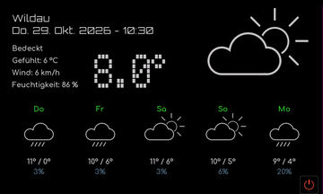](bilder/bedienung/wetter-uebersicht.png)

Den Ort unter **Einstellungen -> Wetter** über die deutsche Postleitzahl einstellen. Die Ortssuche benötigt WLAN. Ein persönlicher Wetter-API-Schlüssel wird nicht eingetragen. Das Wettermodul und die Tagesansicht verwenden denselben gespeicherten Standort. Datenquelle: [Open-Meteo](https://open-meteo.com/).

## Pomodoro und Kurzzeitmesser

Im Pomodoro-Modus startet **Start** einen Arbeitsabschnitt. Während des Laufs wird daraus die Pausenfunktion; ein weiterer Druck setzt den Abschnitt fort. **Stop** bricht ihn ab. Der Kreis und die Restzeit zeigen den Fortschritt. Rechts stehen die Sitzung innerhalb des Viererblocks und die heute abgeschlossenen Pomodoros.

| Bereit | Laufend | Unterbrochen |
| --- | --- | --- |
| [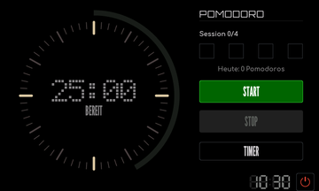](bilder/bedienung/pomodoro-uebersicht.png) | [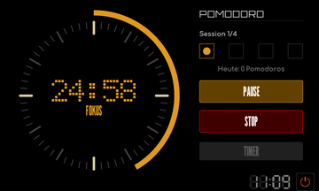](bilder/bedienung/pomodoro-laufend.png) | [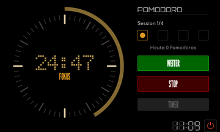](bilder/bedienung/pomodoro-pausiert.png) |

Die Taste **Timer** wechselt im angehaltenen Ausgangszustand zum einfachen Kurzzeitmesser. Dort mit Minus und Plus eine der angebotenen Dauern wählen und starten. Mit der Modustaste wieder zu Pomodoro zurückwechseln. Während eines laufenden Abschnitts ist der Moduswechsel gesperrt.

| Timer einstellen | Timer läuft |
| --- | --- |
| [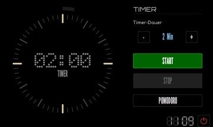](bilder/bedienung/pomodoro-timer.png) | [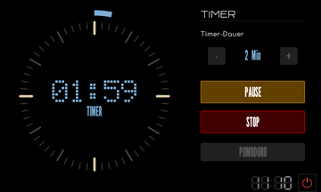](bilder/bedienung/pomodoro-timer-laufend.png) |

## Auszeit

Die Auswahl bietet sechs kurze Programme: **Bin angespannt**, **Bin müde**, **Bin zappelig**, **Augen-Pause**, **Quadratatmung** und **Atemberuhigung**. Tippe die passende Kachel an. Die jeweilige Dauer steht bereits in der Auswahl.

[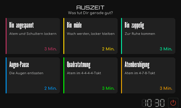](bilder/bedienung/atempause-uebersicht.png)

Folge den eingeblendeten Schritten beziehungsweise dem angezeigten Atemrhythmus. Unten führen **Zurück** zur Auswahl, **Pause/Weiter** zum Unterbrechen und Fortsetzen und die weitere Schritttaste zum nächsten Abschnitt. Die Taste ganz rechts verlässt die Anwendung.

| Anspannung | Müdigkeit | Unruhe |
| --- | --- | --- |
|  | [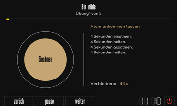](bilder/bedienung/auszeit-muede.png) | [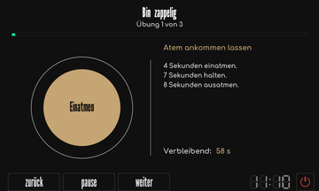](bilder/bedienung/auszeit-zappelig.png) |

| Augen-Pause | Quadratatmung | Atemberuhigung |
| --- | --- | --- |
| [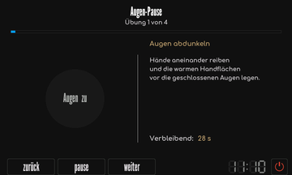](bilder/bedienung/auszeit-augen.png) |  | [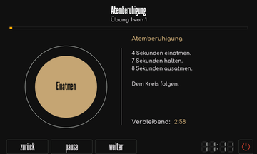](bilder/bedienung/auszeit-atemberuhigung.png) |

## Einstellungen

Links den Einstellbereich auswählen, rechts dessen Felder bearbeiten. Längere Texte werden über eine Bildschirmtastatur eingegeben, Zahlen über die angezeigten Zahlentasten. Persönliche Netzwerkangaben sind in den Beispielbildern absichtlich unscharf.

| Bereich | Bedienung | Beispiel |
| --- | --- | --- |
| WLAN | Profile einzeln aktivieren, Netze suchen, Passwort eingeben, Verbindung testen und Netzwerknamen ändern. | [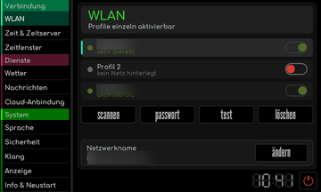](bilder/bedienung/einstellungen-wlan.png) |
| Zeit & Zeitserver | Zeitzone, Zeitserver und Synchronisation einstellen; bei Bedarf Uhrzeit manuell setzen. | [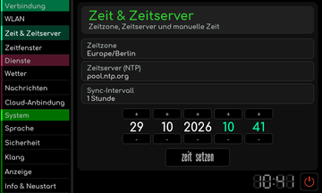](bilder/bedienung/einstellungen-zeit.png) |
| Zeitfenster | Betriebszeiten des Displays über die angebotene Wochenübersicht festlegen. | [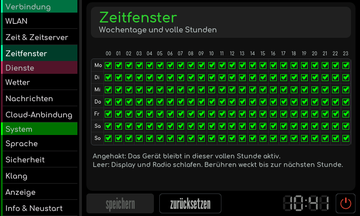](bilder/bedienung/einstellungen-zeitfenster.png) |
| Wetter | Deutsche Postleitzahl eingeben; Ort und Koordinaten werden ermittelt. | [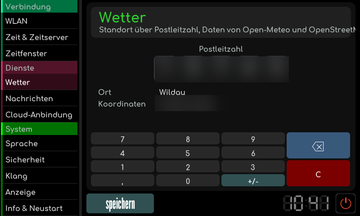](bilder/bedienung/einstellungen-wetter.png) |
| Nachrichten | Gewünschtes Nachrichtenressort für die Laufzeile auswählen. | [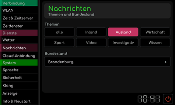](bilder/bedienung/einstellungen-nachrichten.png) |
| Cloud-Anbindung | Eigene Google-Web-App-Adressen und OpenSky-Zugang eintragen; [Dienste einrichten](dienste/README.md). | [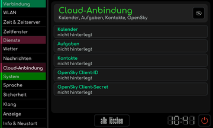](bilder/bedienung/einstellungen-cloud.png) |
| Sprache | Deutsch oder Englisch auswählen. | [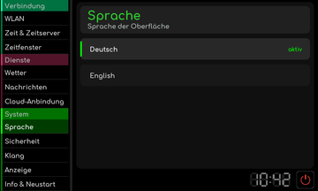](bilder/bedienung/einstellungen-sprache.png) |
| Sicherheit | Vierstelligen Code für den Sperrbildschirm ändern. | [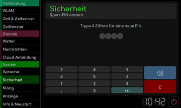](bilder/bedienung/einstellungen-sicherheit.png) |
| Klang | Lautstärke, Balance, Tiefen, Mitten, Höhen und Lautsprecherfreigabe einstellen. | [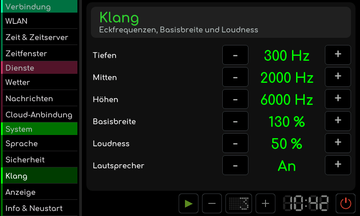](bilder/bedienung/einstellungen-klang.png) |
| Anzeige | Die angebotenen Darstellungs- und Anzeigeoptionen wählen. | [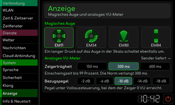](bilder/bedienung/einstellungen-anzeige.png) |
| Info & Neustart | Netzwerk- und Geräteinformationen lesen; Neustart oder Zurücksetzen gezielt auslösen. | [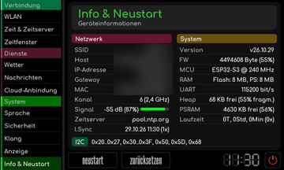](bilder/bedienung/einstellungen-info.png) |

Unter **Klang -> Lautsprecher** schaltet Minus die beiden eingebauten Lautsprecher aus, Plus schaltet sie ein. Die Änderung wirkt sofort. **Speichern** übernimmt sie dauerhaft; beim Verwerfen wird der gespeicherte Zustand wiederhergestellt. Der Stereo-Line-Out bleibt bei abgeschalteten Lautsprechern aktiv. Diese Funktion ist unabhängig von Mute und von der gewählten Wiedergabelautstärke.

**Alle löschen** im Cloud-Bereich betrifft sämtliche dortigen Werte, einschließlich OpenSky. Für den Demomodus einzelner Google-Anwendungen nur die zugehörigen Adressen leeren. **Zurücksetzen** und **Werkseinstellungen** sind keine normalen Beenden-Tasten; sie verändern gespeicherte Einstellungen.

## Sperren und Ausschalten

Das Hauptmenü bietet den Ausschaltknopf unten rechts. Die Sperr- und Aufweckansicht wird über den vierstelligen Code freigegeben. Der Code ist in den Sicherheitseinstellungen änderbar. Die Netzwerkverbindung des Geräts und die Weboberfläche sind getrennt vom sichtbaren Display zu betrachten; Details zu deren Zugriff stehen in der [Webanleitung](Weboberfläche.md).

| Gesperrt | Code eingeben |
| --- | --- |
|  |  |

Bei unerwartetem Verhalten hilft die [Fehlerhilfe](Fehlerhilfe.md). Aufbau und Firmwareauswahl stehen in der [Hardwareanleitung](Aufbau.md) und der [Erstinstallation](RetroRadio-Ersteinrichtung.md).
