# Aufbaufotos

Die Vorschaubilder öffnen beim Anklicken das große Foto. Hauptvariante ist Rev.2 mit Visaton BF 37; ausdrücklich als Rev.1 bezeichnete Bilder dokumentieren den früheren Aufbau. Die Flashgrößen 8 und 16 MB sind davon unabhängig.

Die Originale bleiben privat erhalten. Diese Veröffentlichungskopien sind richtig ausgerichtet, auf höchstens 2400 Pixel verkleinert und ohne Standortdaten oder eingebettete Kommentare gespeichert. Sichtbare Netzwerkangaben sind unscharf gemacht. Bildinhalte wurden nicht ergänzt.

| Foto | Vorschau | Beschreibung |
| --- | --- | --- |
| F01 | [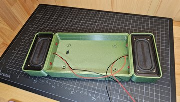](bilder/aufbau/20260529_212016.jpg) | Frühere Rev.1 mit Visaton SC 4.9 FL und 8 Ohm. |
| F02 | [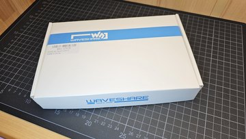](bilder/aufbau/20260529_212156.jpg) | Verpackung des Waveshare ESP32-S3-Touch-LCD-7. |
| F03 | [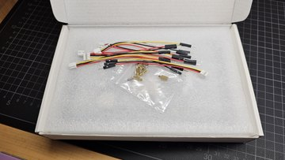](bilder/aufbau/20260529_212209.jpg) | Mitgelieferte Kabel und Abstandshalter. |
| F04 | [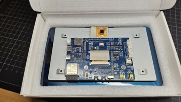](bilder/aufbau/20260529_212225.jpg) | Displayeinheit mit Platine auf der Rückseite. |
| F05 | [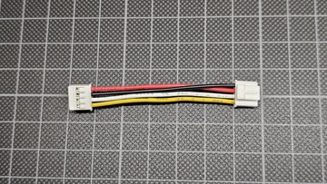](bilder/aufbau/20260530_205745.jpg) | I2C-Kabel zur RTC: Die Adern müssen wie gezeigt umgesetzt werden, damit Versorgung und Masse stimmen. |
| F06 | [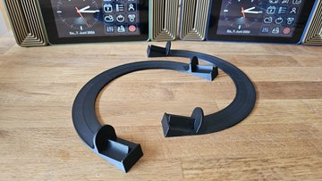](bilder/aufbau/20260607_141526.jpg) | Gedruckte Aufsteller. |
| F07 | [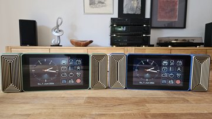](bilder/gerät/20260607_141617.jpg) | Zwei fertige RetroRadios. Beide Aufbauversionen haben dieselbe Frontansicht; fotografiert ist Rev.1. |
| F08 | [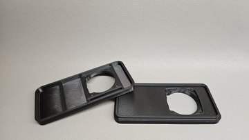](bilder/aufbau/20260822_135305.jpg) | Lautsprechereinsätze für Visaton BF 37 in Rev.2. |
| F09 | [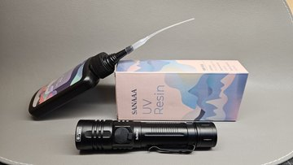](bilder/aufbau/20260822_140909.jpg) | UV-Resin und UV-Lampe für die Verklebung der Einsätze. |
| F10 | [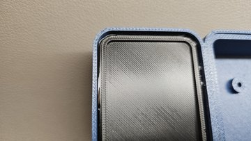](bilder/aufbau/20260822_141135.jpg) | Ausgehärtete Klebenaht am Lautsprechereinsatz. |
| F11 | [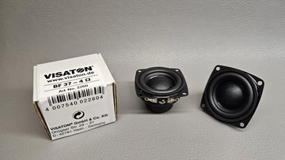](bilder/aufbau/20260822_185122.jpg) | Visaton BF 37 mit 4 Ohm für Rev.2. |
| F12 | [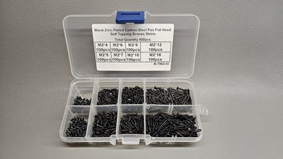](bilder/aufbau/20260822_193423.jpg) | Sortiment mit selbstschneidenden Schrauben für die Baugruppen. |
| F13 | [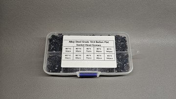](bilder/aufbau/20260822_193522.jpg) | Sortiment mit metrischen Schrauben M2,5 und M3. |
| F14 | [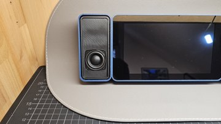](bilder/aufbau/20260822_193828.jpg) | Lautsprecher und Einsatz im Gehäuse der Rev.2. |
| F15 | [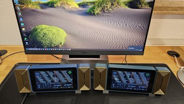](bilder/gerät/20260822_211320.jpg) | Frühere Rev.1 am Arbeitsplatz, Gehäuse aus PETG-CF. |
| F16 | [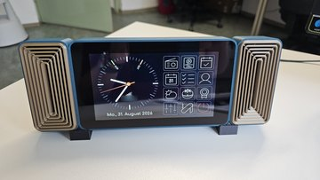](bilder/gerät/20260831_093542.jpg) | Frontansicht eines fertigen RetroRadios der Rev.1. |
| F17 | [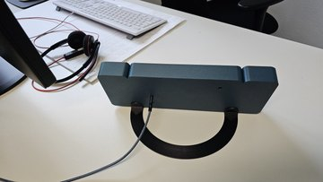](bilder/gerät/20260831_093652.jpg) | Rückansicht der früheren Rev.1 mit Aufsteller. |
| F18 | [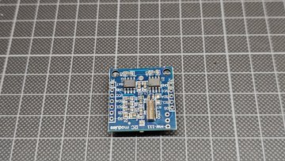](bilder/aufbau/20260923_114835.jpg) | Tiny-RTC-Modul HW-111 im Zwischenstand: D1 bereits entfernt, U3 noch bestückt. |
| F19 | [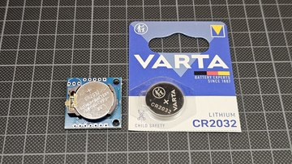](bilder/aufbau/20260923_114943.jpg) | CR2032 als Batterie für die RTC. |
| F20 | [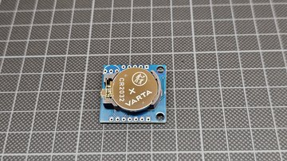](bilder/aufbau/20260923_120530.jpg) | Batterieseite der RTC mit eingesetzter CR2032. |
| F21 | [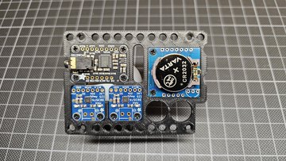](bilder/aufbau/20260923_120917.jpg) | Anordnung von DAC, zwei Verstärkern und RTC auf der Grundplatte. |
| F22 | [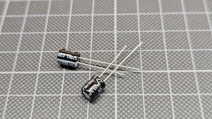](bilder/aufbau/20260923_122918.jpg) | Zwei Elkos mit 100 µF und 25 V für die Verstärkerversorgung. |
| F23 | [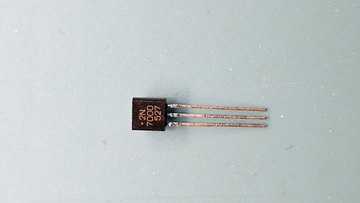](bilder/aufbau/20260923_135827.jpg) | 2N7000 als fotografierte Variante der Lautsprecherabschaltung. |
| F24 | [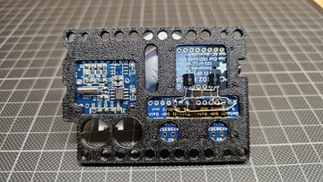](bilder/aufbau/20260923_143153.jpg) | Eingebaute FETs der Variante mit 2N7000. |
| F25 | [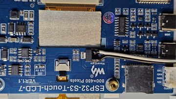](bilder/aufbau/20260923_191638.jpg) | Abgriff der 5-V-Versorgung am Spannungsregler der Displayplatine. |
| F26 | [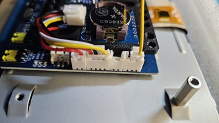](bilder/aufbau/20260924_121947.jpg) | Rechte Steckverbinder am bestückten Display. |
| F27 | [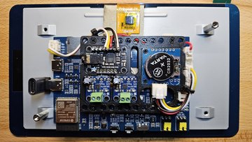](bilder/aufbau/20260925_202741.jpg) | Vollständige Verdrahtung der Rev.2. |
| F28 | [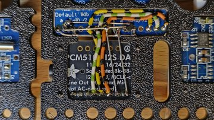](bilder/aufbau/20260929_124701.jpg) | Ausführung der Lautsprecherabschaltung mit AO3400. |
| F29 | [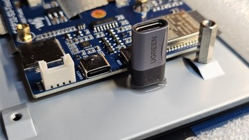](bilder/aufbau/20261001_193314.jpg) | USB-C-Adapter mit Abstützung aus UV-Resin. |
| F30 | [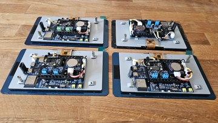](bilder/aufbau/20261003_133322.jpg) | Vier bestückte Displayeinheiten der Rev.2. |
| F31 | [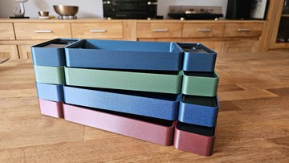](bilder/aufbau/20261003_133907.jpg) | Gehäusevarianten der Rev.2 von der Seite. |
| F32 | [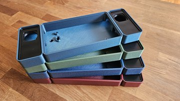](bilder/aufbau/20261003_134104.jpg) | Gehäusevarianten der Rev.2 von oben. |
| F33 | [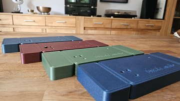](bilder/aufbau/20261003_134301.jpg) | Gehäusevarianten der Rev.2 von hinten. |
| F34 | [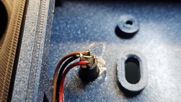](bilder/aufbau/20261007_200803.jpg) | Herausgeführte 3,5-mm-Buchse für den Line-Out. |
| F35 | [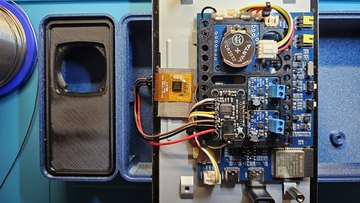](bilder/aufbau/20261007_202331.jpg) | Verdrahtung der Line-Out-Buchse im offenen Aufbau. |
| F36 | [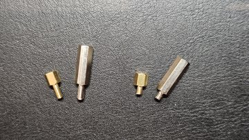](bilder/aufbau/20261028_213523.jpg) | Befestigungsbolzen: links original, rechts gekürzte Außengewinde. Die Bolzenkörper bleiben 4 mm beziehungsweise 15 mm lang. |
