# Radio und Musik

[RetroRadio](../README.md) > [Dokumentation](../README.md#dokumentation) > Radio und Musik

[Zur allgemeinen Bedienung](Bedienung.md)

## Internetradio

Öffne im Hauptmenü das Radiosymbol. Die große Analogskala zeigt die Sender, der rote Zeiger bewegt sich zum ausgewählten Eintrag. Ein Tipp auf einen Sender wählt ihn aus. Unten stehen Lautstärke, Balance und die drei Klangregler. Die Pfeiltasten wechseln zum vorherigen oder nächsten Sender. Der Stern öffnet die Favoriten.

| Radio | Favoriten | Ausschalt- und Sleep-Timer |
| --- | --- | --- |
|  | [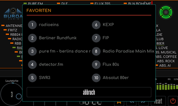](bilder/bedienung/radio-senderspeicher.png) | [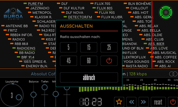](bilder/bedienung/radio-sleeptimer.png) |

Der Lautstärkeknopf reagiert auf eine Drehbewegung am äußeren Bereich. Ein Tipp in die Mitte schaltet stumm beziehungsweise hebt die Stummschaltung auf. Balance, Tiefen, Mitten und Höhen werden an den zugehörigen Reglern eingestellt. Sendernamen, Streamadressen und Favoriten lassen sich in der [Weboberfläche](Weboberfläche.md) pflegen.

Der Ausschaltknopf öffnet den Sleep-Timer mit **5, 15, 25, 45 und 60 Minuten** sowie dem Symbol für sofortiges Beenden. **Abbruch** schließt den Dialog. Nach Auswahl einer Zeit läuft die Wiedergabe bis zum Ablauf weiter. **Reset** öffnet einen eigenen Bestätigungsdialog, die Funktion nicht mit dem normalen Beenden verwechseln.

## Alle acht Visualisierungen

**Im Visualisierungsbereich waagerecht wischen**, um den Modus zu wechseln. **Länger als etwa eine Sekunde drücken**, um innerhalb des Modus die zweite Darstellung auszuwählen. Alle acht Modi bieten zwei Varianten. Die Galerie zeigt echte Aufnahmen der laufenden Wiedergabe mit Lautstärke 3 und ohne Stummschaltung. Ein Klick auf das Vorschaubild öffnet die volle Displayaufnahme.

| Modus | Erste Variante | Zweite Variante |
| --- | --- | --- |
| Analoges VU-Meter | [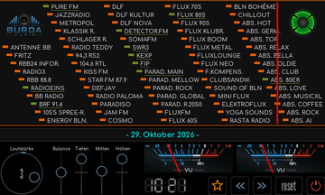](bilder/bedienung/radio-visualizer-analog-a.png) | [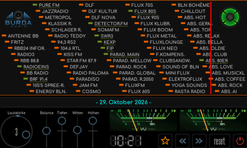](bilder/bedienung/radio-visualizer-analog-b.png) |
| Digitales VU-Meter | [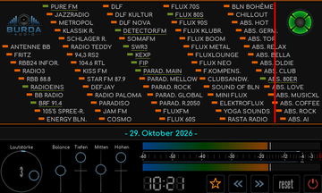](bilder/bedienung/radio-visualizer-digital-a.png) | [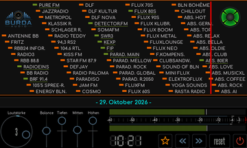](bilder/bedienung/radio-visualizer-digital-b.png) |
| Spektrumanalysator | [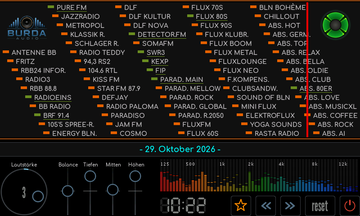](bilder/bedienung/radio-visualizer-spektrum-a.png) | [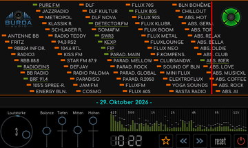](bilder/bedienung/radio-visualizer-spektrum-b.png) |
| Wellenform | [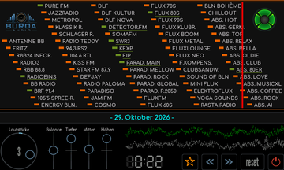](bilder/bedienung/radio-visualizer-welle-a.png) | [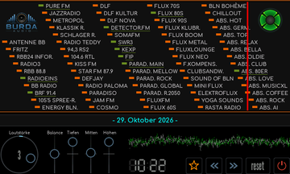](bilder/bedienung/radio-visualizer-welle-b.png) |
| Goniometer | [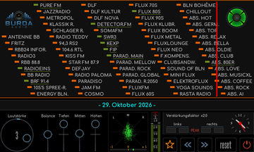](bilder/bedienung/radio-visualizer-goniometer-a.png) | [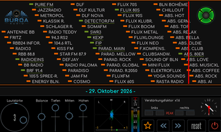](bilder/bedienung/radio-visualizer-goniometer-b.png) |
| Mittiges Spektrum | [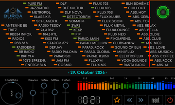](bilder/bedienung/radio-visualizer-mittig-a.png) | [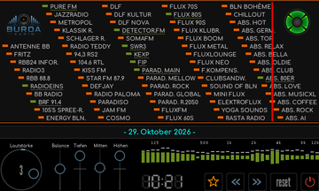](bilder/bedienung/radio-visualizer-mittig-b.png) |
| Wasserfall | [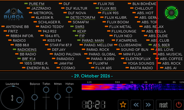](bilder/bedienung/radio-visualizer-wasserfall-a.png) | [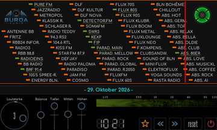](bilder/bedienung/radio-visualizer-wasserfall-b.png) |
| Nordlicht | [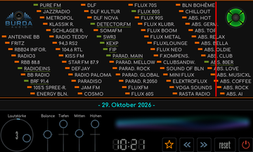](bilder/bedienung/radio-visualizer-nordlicht-a.png) | [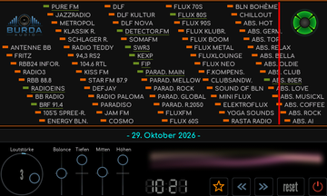](bilder/bedienung/radio-visualizer-nordlicht-b.png) |

Die Anzeigen folgen den Audiodaten. Bei angehaltener Wiedergabe oder sehr leisem Signal sind entsprechend wenige Ausschläge sichtbar. Die Visualisierungen stehen auch im SD-Player zur Verfügung.

## Vier magische Augen

Ein langer Druck auf das magische Auge oben rechts schaltet reihum durch **EM11, EM34, EM80 und EM84**. Es ist eine grafische Nachbildung, keine zusätzliche Röhre im Hardwareaufbau.

| EM11 | EM34 | EM80 | EM84 |
| --- | --- | --- | --- |
| [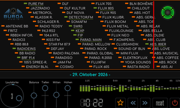](bilder/bedienung/radio-auge-1.png) | [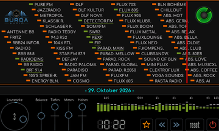](bilder/bedienung/radio-auge-2.png) | [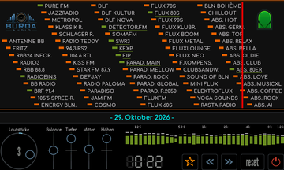](bilder/bedienung/radio-auge-3.png) | [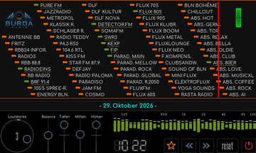](bilder/bedienung/radio-auge-4.png) |

## SD-Player

Der SD-Player verbindet eine animierte Kassette, Coveranzeige, Titelinformationen und eine scrollbare Titelliste. Die fünf Tasten unter der Kassette stehen für vorherigen Titel, Wiedergabe, Pause, Stop und nächsten Titel. Der Fortschritt zeigt verstrichene und gesamte Spielzeit. Ein Tipp in die Titelliste startet den betreffenden Titel.

| Laufende Wiedergabe mit Cover | Pause | Noch keine Titel |
| --- | --- | --- |
|  | [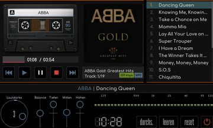](bilder/bedienung/sdplayer-pause.png) | [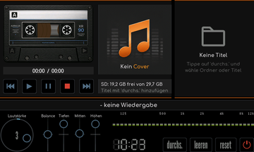](bilder/bedienung/sdplayer-uebersicht.png) |

### Musik auswählen

**Durchs.** öffnet die Dateiauswahl. Ein kurzer Tipp öffnet einen Ordner, **..** führt eine Ebene zurück. Dateien beziehungsweise ein ganzer Ordner lassen sich durch längeres Drücken auswählen. Die Auswahl wird unten zusammengefasst. **OK** übernimmt sie in die Titelliste, **Abbruch** schließt den Dialog ohne Übernahme. Bereits enthaltene Dateien werden beim Hinzufügen übersprungen.

| Dateiauswahl | Musikordner | Albumordner | Ordner ausgewählt |
| --- | --- | --- | --- |
| [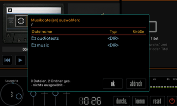](bilder/bedienung/sdplayer-dateiauswahl.png) | [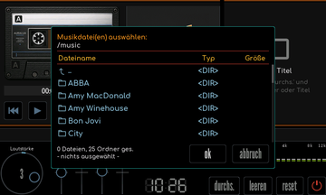](bilder/bedienung/sdplayer-musikordner.png) | [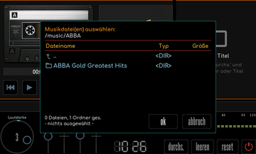](bilder/bedienung/sdplayer-albumauswahl.png) | [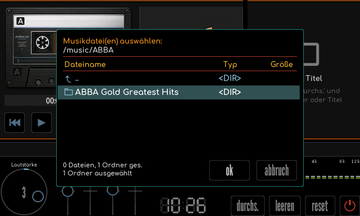](bilder/bedienung/sdplayer-ordner-ausgewaehlt.png) |

Die Titel werden über die Wiedergabetaste gestartet. Die Coveranzeige hängt von den Metadaten der Musikdatei ab, ohne lesbares Cover erscheint der Platzhalter. **Leeren** entfernt die Titelliste, nicht die Musikdateien auf der SD-Karte. Der Ausschaltknopf öffnet den Sleep-Timer. Lautstärke, Balance, Klang und Visualisierungswechsel funktionieren wie im Radio.

Die Abbildungen zeigen die Wiedergabe einer vorhandenen Musikdatei zur Demonstration. Titel, Künstlernamen und eingeblendetes Albumcover gehören zum dargestellten Musikinhalt, Musikdateien sind nicht Bestandteil des Repositorys.

### Kassetten wechseln

Ein Tipp auf die Kassette wechselt zur nächsten der acht Gestaltungen. Die Wickel und Naben werden bei der Wiedergabe animiert. Die Gestaltung ändert nicht die Musikauswahl.

| Variante 1 | Variante 2 | Variante 3 | Variante 4 |
| --- | --- | --- | --- |
| [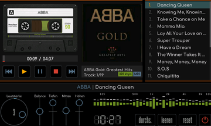](bilder/bedienung/sdplayer-kassette-1.png) | [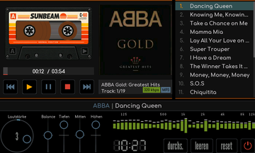](bilder/bedienung/sdplayer-kassette-2.png) | [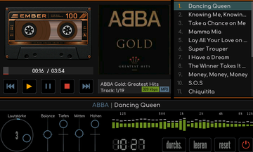](bilder/bedienung/sdplayer-kassette-3.png) | [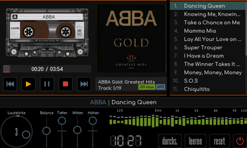](bilder/bedienung/sdplayer-kassette-4.png) |

| Variante 5 | Variante 6 | Variante 7 | Variante 8 |
| --- | --- | --- | --- |
| [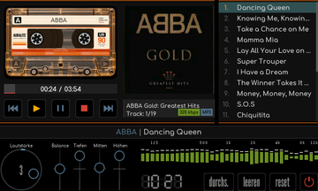](bilder/bedienung/sdplayer-kassette-5.png) | [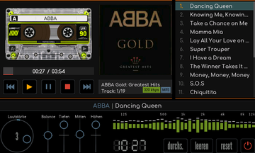](bilder/bedienung/sdplayer-kassette-6.png) | [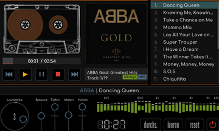](bilder/bedienung/sdplayer-kassette-7.png) | [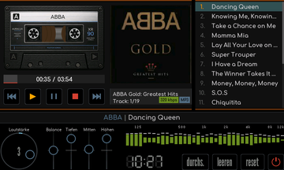](bilder/bedienung/sdplayer-kassette-8.png) |

## Dateien übertragen und Lautsprecher abschalten

Musik kann über einen Kartenleser auf die SD-Karte kopiert werden. Bei eingelegter Karte stehen zusätzlich die [Web-Dateiverwaltung und FTP](Weboberfläche.md#dateien-auf-der-sd-karte) zur Verfügung. Über **Einstellungen -> Klang -> Lautsprecher** lassen sich die beiden eingebauten Lautsprecher abschalten, während der Stereo-Line-Out weiterläuft.

[RetroRadio](../README.md) > [Dokumentation](../README.md#dokumentation) > Radio und Musik
