# Radio und Musik

[RetroRadio](../README.md) > [Dokumentation](../README.md#dokumentation) > Radio und Musik

[Zur allgemeinen Bedienung](Bedienung.md)

## Internetradio

Öffne im Hauptmenü das Radiosymbol. Die große Analogskala zeigt die Sender, der rote Zeiger bewegt sich zum ausgewählten Eintrag. Ein Tipp auf einen Sender wählt ihn aus. Unten stehen Lautstärke, Balance und die drei Klangregler. Die Pfeiltasten wechseln zum vorherigen oder nächsten Sender. Der Stern öffnet die Favoriten.

| Radio | Favoriten | Sleep-Timer |
| --- | --- | --- |
|  | [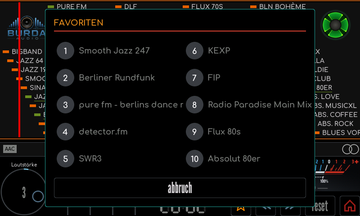](bilder/bedienung/radio-senderspeicher.png) | [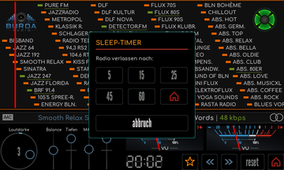](bilder/bedienung/radio-sleeptimer.png) |

Links in der Infozeile unter der Radioskala erscheint das erkannte Audioformat, beispielsweise MP3, AAC, Vorbis oder FLAC. Beim Senderwechsel wird das bisherige Format ausgeblendet, bis das neue erkannt wurde. Das Stereo-Symbol rechts berücksichtigt die tatsächliche Mono-Erkennung des Audiosignals, kurze Schwankungen unter einer halben Sekunde ändern die Anzeige nicht.

Der Lautstärkeknopf reagiert auf eine Drehbewegung am äußeren Bereich. Ein Tipp in die Mitte schaltet stumm beziehungsweise hebt die Stummschaltung auf. Auch beim Herunterdrehen auf Lautstärke null erscheint das Mute-Symbol und die Visualisierungen gehen auf null. Durch Hochdrehen wird die Wiedergabe wieder hörbar, sofern sie nicht zusätzlich per Tipp stummgeschaltet wurde. Balance, Tiefen, Mitten und Höhen stellst Du durch Ziehen ein. Hältst Du einen Reglerkreis etwa 0,8 Sekunden ruhig gedrückt, springt nur dieser Regler auf die Mittellinie (Balance 0 oder 0 dB). Sendernamen, Streamadressen und Favoriten lassen sich in der [Weboberfläche](Weboberfläche.md) pflegen.

Das Haus unten rechts öffnet den Sleep-Timer mit **5, 15, 25, 45 und 60 Minuten**. Ein Tipp auf das Haus im Dialog beendet die Wiedergabe sofort und führt zurück ins Hauptmenü. **Abbruch** schließt den Dialog. Nach Auswahl einer Zeit läuft die Wiedergabe bis zum Ablauf weiter. **Reset** öffnet einen eigenen Bestätigungsdialog, die Funktion nicht mit dem normalen Beenden verwechseln.

## Alle acht Visualisierungen

**Im Visualisierungsbereich waagerecht wischen**, um den Modus zu wechseln. **Länger als etwa eine Sekunde drücken**, um innerhalb des Modus die zweite Darstellung auszuwählen. Alle acht Modi bieten zwei Varianten. Beim Goniometer wechselt dabei nur die Farbgebung der VU-Balken zwischen klassisch und Regenbogen. Die Goniometer-Figur bleibt in beiden Varianten grün. Die mehrfarbigen VU-Balken des Goniometers und des digitalen horizontalen VU-Meters beginnen bei Grün und gehen fließend bis Rot über. Die Hintergründe der beiden analogen VU-Varianten zeigen gleichmäßige Farbverläufe. Das gilt im Radio und im SD-Player. Die Galerie zeigt echte Aufnahmen der laufenden Wiedergabe mit Lautstärke 3 und ohne Stummschaltung. Ein Klick auf das Vorschaubild öffnet die volle Displayaufnahme.

| Modus | Erste Variante | Zweite Variante |
| --- | --- | --- |
| Analoges VU-Meter | [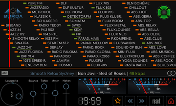](bilder/bedienung/radio-visualizer-analog-a.png) | [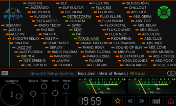](bilder/bedienung/radio-visualizer-analog-b.png) |
| Digitales VU-Meter | [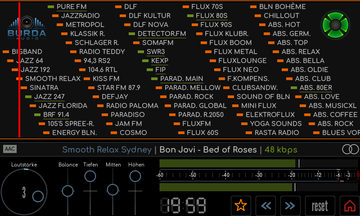](bilder/bedienung/radio-visualizer-digital-a.png) | [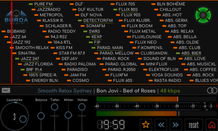](bilder/bedienung/radio-visualizer-digital-b.png) |
| Spektrumanalysator | [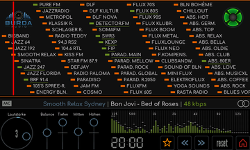](bilder/bedienung/radio-visualizer-spektrum-a.png) | [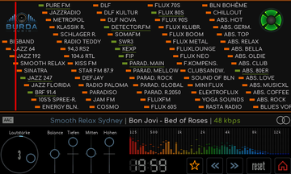](bilder/bedienung/radio-visualizer-spektrum-b.png) |
| Wellenform | [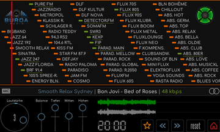](bilder/bedienung/radio-visualizer-welle-a.png) | [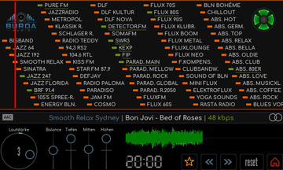](bilder/bedienung/radio-visualizer-welle-b.png) |
| Goniometer | [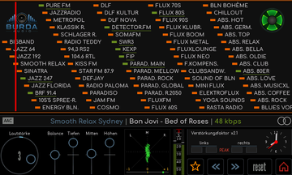](bilder/bedienung/radio-visualizer-goniometer-a.png) | [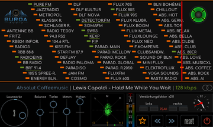](bilder/bedienung/radio-visualizer-goniometer-b.png) |
| Mittiges Spektrum | [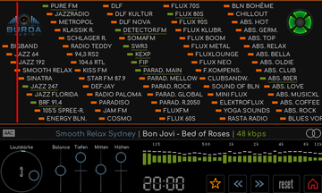](bilder/bedienung/radio-visualizer-mittig-a.png) | [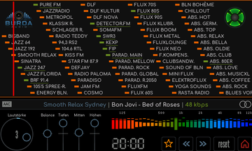](bilder/bedienung/radio-visualizer-mittig-b.png) |
| Wasserfall | [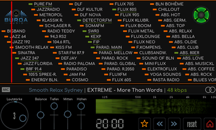](bilder/bedienung/radio-visualizer-wasserfall-a.png) | [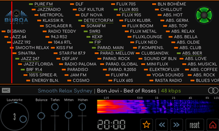](bilder/bedienung/radio-visualizer-wasserfall-b.png) |
| Nordlicht | [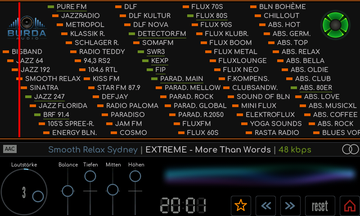](bilder/bedienung/radio-visualizer-nordlicht-a.png) | [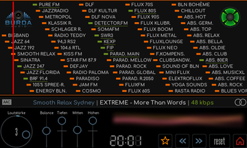](bilder/bedienung/radio-visualizer-nordlicht-b.png) |

Die Anzeigen folgen den Audiodaten. Bei angehaltener Wiedergabe oder sehr leisem Signal sind entsprechend wenige Ausschläge sichtbar. Die Visualisierungen stehen auch im SD-Player zur Verfügung.

## Vier magische Augen

Ein langer Druck auf das magische Auge oben rechts schaltet reihum durch **EM11, EM34, EM80 und EM84**. Es ist eine grafische Nachbildung, keine zusätzliche Röhre im Hardwareaufbau.

Beim Senderwechsel begleitet das magische Auge weiterhin die Zeigerfahrt. Sobald der Zeiger seine Zielposition erreicht hat, zeigt es die aktuelle WLAN-Signalstärke an: Je stärker das Signal, desto weiter schließt sich das Auge beziehungsweise wächst das Leuchtband. Der Wert wird etwa alle 1,5 Sekunden aktualisiert, sodass auch Empfangsschwankungen bei laufendem Sender sichtbar werden. Ohne WLAN-Verbindung zeigt das Auge den minimalen Ausschlag. Angezeigt wird die Funkverbindung zum WLAN-Router.

Für das magische Auge gilt folgende Anzeigeskala:

| WLAN-Signalstärke | Ausschlag des magischen Auges |
| --- | --- |
| -55 dBm oder stärker | Vollständig geschlossen, 100 Prozent |
| -70 dBm | Halber Ausschlag, 50 Prozent |
| -85 dBm oder schwächer | Vollständig offen, 0 Prozent |

Zwischen diesen Werten ändert sich der Ausschlag stufenlos. Die Prozentangaben beschreiben den Anzeigebereich des Auges. Die vier Bauformen behalten ihre jeweils typische Darstellung.

| EM11 | EM34 | EM80 | EM84 |
| --- | --- | --- | --- |
| [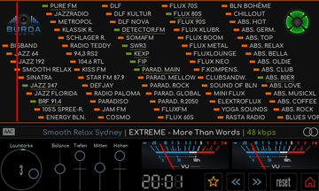](bilder/bedienung/radio-auge-1.png) | [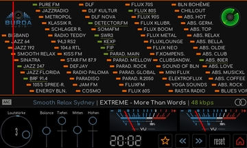](bilder/bedienung/radio-auge-2.png) | [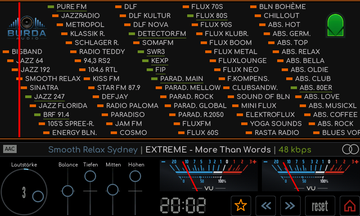](bilder/bedienung/radio-auge-3.png) | [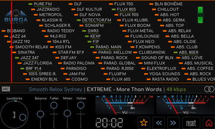](bilder/bedienung/radio-auge-4.png) |

## SD-Player

Der SD-Player verbindet eine animierte Kassette, Coveranzeige, Titelinformationen und eine scrollbare Titelliste. Die fünf Tasten unter der Kassette stehen für vorherigen Titel, Wiedergabe, Pause, Stop und nächsten Titel. Der Fortschritt zeigt verstrichene und gesamte Spielzeit. Ein Tipp in die Titelliste startet den betreffenden Titel.

| Laufende Wiedergabe mit Ordnercover | Pause | Noch keine Titel |
| --- | --- | --- |
| [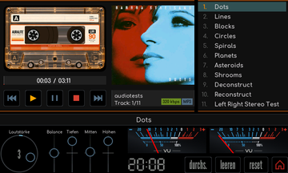](bilder/bedienung/sdplayer-cover-wiedergabe.png) |  | [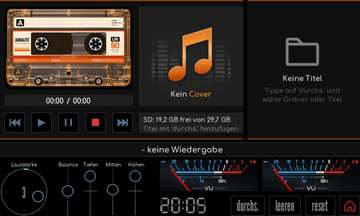](bilder/bedienung/sdplayer-uebersicht.png) |

### SD-Karte auswählen

Für den SD-Player wird eine schnelle microSD-Karte mit **mindestens Class 10 und höchstens 32 GB** empfohlen. Die bisherigen Geräteerfahrungen zeigen zuverlässigere Wiedergabe mit schnellen Karten. Im RetroRadio wurden **SanDisk Extreme 32 GB** und **SanDisk Ultra 32 GB** erprobt. Für andere Kartenmodelle liegt keine vergleichbare Bestätigung vor, Karten mit mehr als 32 GB werden für dieses Projekt nicht empfohlen.

### Musik auswählen

**Durchs.** öffnet die Dateiauswahl. Ein kurzer Tipp öffnet einen Ordner, **..** führt eine Ebene zurück. Dateien beziehungsweise ein ganzer Ordner lassen sich durch längeres Drücken auswählen. Die Auswahl wird unten zusammengefasst. **OK** übernimmt sie in die Titelliste, **Abbruch** schließt den Dialog ohne Übernahme. Bereits enthaltene Dateien werden beim Hinzufügen übersprungen.

| Dateiauswahl | Musikordner | Albumordner | Ordner ausgewählt |
| --- | --- | --- | --- |
| [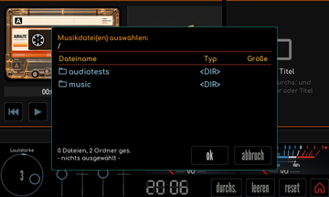](bilder/bedienung/sdplayer-dateiauswahl.png) | [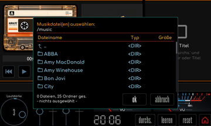](bilder/bedienung/sdplayer-musikordner.png) | [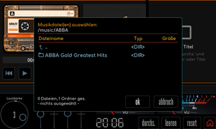](bilder/bedienung/sdplayer-albumauswahl.png) | [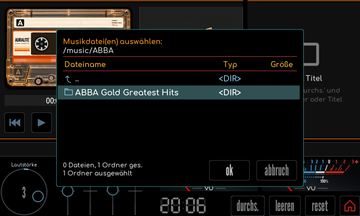](bilder/bedienung/sdplayer-ordner-ausgewaehlt.png) |

Die Titel werden über die Wiedergabetaste gestartet. Für die Coveranzeige wird zuerst ein Ordnerbild verwendet, danach das eingebettete Cover der Musikdatei. Ohne nutzbares Bild erscheint der Platzhalter. **Leeren** entfernt die Titelliste, nicht die Musikdateien auf der SD-Karte. Das Haus unten rechts öffnet wie im Radio den Sleep-Timer. Lautstärke, Balance, Klang und Visualisierungswechsel funktionieren wie im Radio.

Die Abbildungen zeigen vorhandene Musikdateien und ein Ordnercover zur Demonstration. Titel, Künstlernamen und Coverabbildungen dienen als Beispiele, Musikdateien sind nicht Bestandteil des Repositorys.

[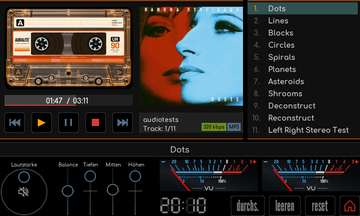](bilder/bedienung/sdplayer-lautstaerke-null.png)

### Ordnercover und Bildgrenzen

Lege ein JPEG-Bild mit dem Namen **`folder.jpg`** in denselben Ordner wie die Musiktitel. Es hat Vorrang vor dem eingebetteten Cover und gilt für alle Titel dieses Ordners. Groß- und Kleinschreibung sind beliebig, beispielsweise funktioniert auch `Folder.JPG`. Eine `folder.png` wird nicht als Ordnerbild gesucht.

Fehlt das Ordnerbild oder ist es zu groß, beschädigt oder nicht ladbar, versucht der Player das eingebettete Cover. Ist auch dieses nicht nutzbar, erscheint der Platzhalter. Dafür wird kein Fehlerdialog geöffnet und die Wiedergabe nicht ausdrücklich angehalten.

| Eigenschaft | Grenze oder Verhalten |
| --- | --- |
| Bildgröße | Höchstens 1 MB pro Bilddatei oder eingebettetem Cover. Die Größe der gesamten Musikdatei ist dafür unerheblich. |
| JPEG | Keine feste Pixelobergrenze. Große Bilder werden bei Bedarf auf 1/2, 1/4 oder 1/8 verkleinert. Sehr große Abmessungen können das Laden dennoch verlangsamen oder verhindern. |
| Eingebettetes PNG | Höchstens 500 x 500 Pixel. |
| Darstellung | 230 x 220 Pixel, ohne Verzerrung skaliert, überstehende Ränder werden mittig beschnitten. |

### Kassetten wechseln

Ein Tipp auf die Kassette wechselt zur nächsten der acht Gestaltungen. Die Wickel und Naben werden bei der Wiedergabe animiert. Die Gestaltung ändert nicht die Musikauswahl.

| Variante 1 | Variante 2 | Variante 3 | Variante 4 |
| --- | --- | --- | --- |
| [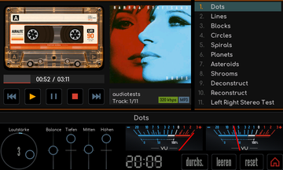](bilder/bedienung/sdplayer-kassette-1.png) | [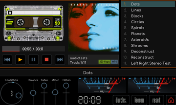](bilder/bedienung/sdplayer-kassette-2.png) | [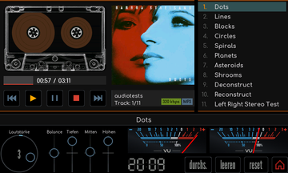](bilder/bedienung/sdplayer-kassette-3.png) | [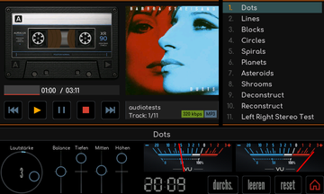](bilder/bedienung/sdplayer-kassette-4.png) |

| Variante 5 | Variante 6 | Variante 7 | Variante 8 |
| --- | --- | --- | --- |
| [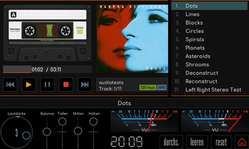](bilder/bedienung/sdplayer-kassette-5.png) | [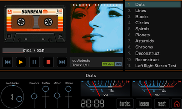](bilder/bedienung/sdplayer-kassette-6.png) | [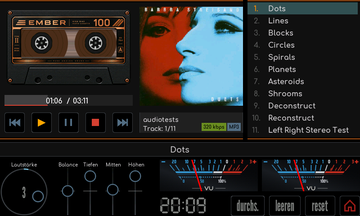](bilder/bedienung/sdplayer-kassette-7.png) | [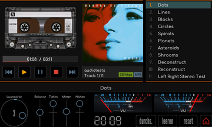](bilder/bedienung/sdplayer-kassette-8.png) |

## Dateien übertragen und Lautsprecher abschalten

Musik kann über einen Kartenleser auf die SD-Karte kopiert werden. Bei eingelegter Karte stehen zusätzlich die [Web-Dateiverwaltung und FTP](Weboberfläche.md#dateien-auf-der-sd-karte) zur Verfügung. Über **Einstellungen -> Klang -> Lautsprecher** lassen sich die beiden eingebauten Lautsprecher abschalten, während der Stereo-Line-Out weiterläuft.

[RetroRadio](../README.md) > [Dokumentation](../README.md#dokumentation) > Radio und Musik
