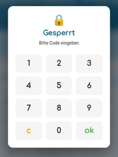
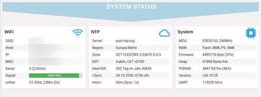
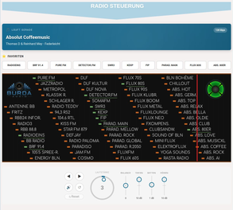
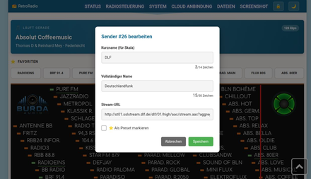
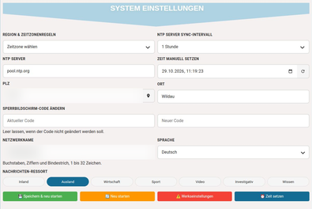
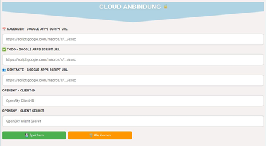
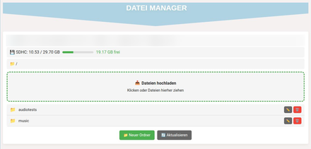
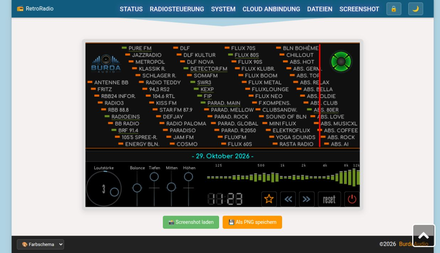

# Weboberfläche

[RetroRadio](../README.md) > [Dokumentation](../README.md#dokumentation) > Weboberfläche

Verbinde Rechner und Radio mit demselben erreichbaren Netzwerk. Die Adresse des Radios steht im Hauptmenü und unter **Einstellungen -> Info**. Öffne diese Adresse im Browser mit `http://` davor. Gib den am Radio eingestellten vierstelligen Sperrcode ein. Die Oberfläche funktioniert im Browser unter Windows, Linux und macOS, für die Bedienung ist kein serieller Monitor erforderlich.

Die Navigationsleiste springt zu den einzelnen Bereichen derselben Seite. Das Schloss sperrt die Browseransicht wieder. Mit dem Mondsymbol wechselst Du zwischen heller und dunkler Darstellung, unten stehen weitere Farbschemata zur Wahl.

## Status

Der Status zeigt WLAN-Verbindung, Zeitsynchronisation und Systemdaten. Hier lassen sich unter anderem Flashgröße, Firmwareversion, freie Ressourcen und die letzte Zeitsynchronisation ablesen. Netzwerkangaben sind in den Abbildungen unkenntlich gemacht.

## Radiosteuerung und Senderpflege

Die Radiosteuerung erscheint, wenn das **Internetradio am Gerät geöffnet** ist. Sie zeigt aktuellen Sender, Titel und Favoriten sowie die Senderskala. Die Regler ändern Lautstärke, Balance, Tiefen, Mitten und Höhen. Die beiden Pfeile wechseln den Sender, die Lautsprechertaste schaltet stumm beziehungsweise wieder hörbar.

Klicke den kleinen farbigen **Sendermarker** auf der Skala an. Die Aktionsleiste bietet Aufrufen, Bearbeiten und Löschen. Ein erneuter Klick auf denselben gepinnten Marker oder ein Doppelklick ruft den Sender auf. Im Bearbeitungsdialog stehen Kurzname für die Skala, vollständiger Name, Stream-Adresse und Favoritenmarkierung. **Speichern** übernimmt die Änderung, **Abbrechen** verwirft sie. Verwende eine tatsächlich erreichbare Audio-Stream-Adresse. HTTP- und HTTPS-Streams werden unterstützt. Bei HTTPS muss das Serverzertifikat akzeptiert werden können, außerdem muss die Gerätezeit stimmen.

**Reset** bei der Senderliste stellt die Werkssender wieder her und überschreibt die eigene Liste. Die getrennte EQ-Rücksetztaste setzt die Klangregelung zurück.

## Systemeinstellungen

Hier richtest Du Zeitzone, Zeitserver, Synchronisationsintervall, Wetterstandort, Sprache, Nachrichtenressort und Gerätenamen ein. Die Browser-Zeit kann in das Eingabefeld übernommen und mit **Zeit setzen** an das Gerät übergeben werden. Ein geänderter Sperrcode wird zweimal eingegeben, bleiben beide Felder leer, bleibt der bisherige Code erhalten.

**Speichern & neu starten** übernimmt die Systemeinstellungen und startet das Radio neu. **Neu starten** und **Werkseinstellungen** sind eigene Aktionen. Ein Zurücksetzen löscht persönliche Einstellungen, es ist kein normaler Schritt für ein Firmware-Update.

## Cloud-Anbindung

Trage hier die drei eigenen Google-Web-App-Adressen und bei Bedarf den OpenSky-Client ein. Die Schloss-Taste neben der Überschrift zeigt beziehungsweise verbirgt die Adressen. **Speichern** übernimmt die Werte. **Alle löschen** entfernt die gespeicherten Verbindungen, Kalender, Aufgaben und Kontakte können anschließend ihre eingebauten Demodaten anzeigen.

Die vollständigen Einrichtungsschritte stehen unter [Google](dienste/google/README.md) und [Flugradar/OpenSky](dienste/Flugradar.md). Die abgebildeten Felder enthalten keine persönlichen Verbindungen.

## Dateien auf der SD-Karte

Der Dateimanager zeigt Ordner und Dateien der eingelegten Karte. Öffne Ordner durch Anklicken. Über die Pfadleiste gelangst Du zurück. Dateien lassen sich über die Upload-Fläche auswählen oder hineinziehen. Die Aktionen an einem Eintrag dienen zum Umbenennen beziehungsweise Löschen, **Neuer Ordner** legt einen Ordner im angezeigten Pfad an.

Alternativ ist FTP über die im Dateibereich angezeigte Adresse und die dort genannten Zugangsdaten möglich. Verwende eigene Musikdateien und halte vor dem Löschen oder Ersetzen eine Sicherung vor. Das Projekt enthält keine Musiksammlung. Für die Ordnerauswahl und Coveranzeige am Gerät siehe [SD-Player](Radio-und-Musik.md#sd-player).

## Display aufnehmen

**Screenshot laden** liest das aktuelle Gerätebild ein. Warte, bis die Vorschau vollständig erscheint. Danach speichert **Als PNG speichern** die Aufnahme auf dem Rechner. Ein neues Bild wird erst nach einem erneuten Laden abgerufen. Die Vorschau ist kein Livevideo.

## Netzwerkzugriff

Weboberfläche und FTP sind für das eigene vertrauenswürdige Netzwerk vorgesehen. Der Sperrcode sperrt die Browseransicht, er stellt keine umfassende Anmeldung für sämtliche Geräteschnittstellen dar. HTTP und FTP übertragen unverschlüsselt. Richte keine öffentliche Portweiterleitung zum Radio ein. Google-Web-App-Adressen und OpenSky-Zugangsdaten gehören weder in öffentliche Bilder noch in das Repository.

[Zur Gerätebedienung](Bedienung.md) | [Fehlerhilfe](Fehlerhilfe.md)

[RetroRadio](../README.md) > [Dokumentation](../README.md#dokumentation) > Weboberfläche
