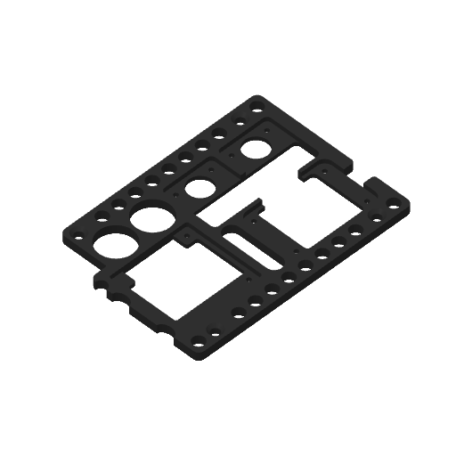
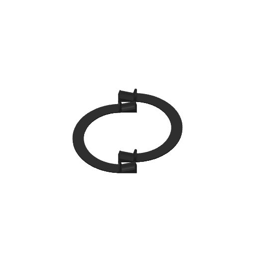
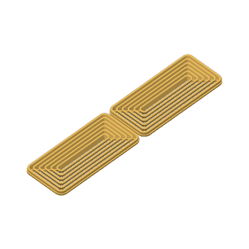
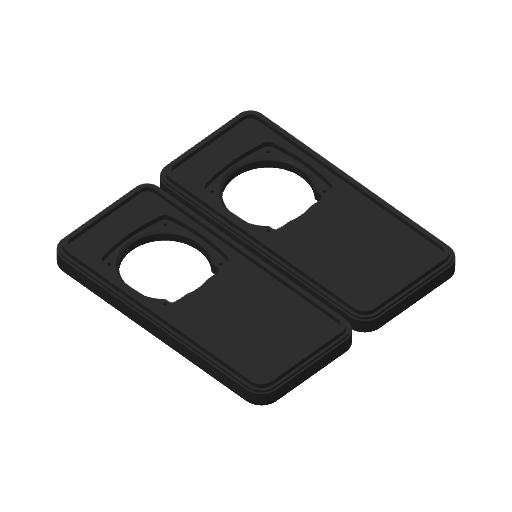
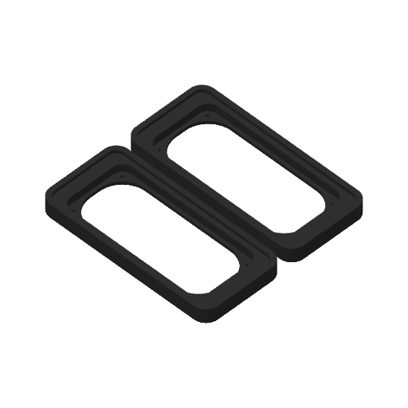

# Gehäuse, Druckdateien und Befestigung

Die Konstruktion besteht aus Gehäuse, Lautsprecherabdeckung, Lautsprechereinsätzen, einer Grundplatte für die Baugruppen und einem Aufsteller. Die Rev.2 verwendet Visaton BF 37 mit 4 Ohm. Für die frühere Rev.1 ist zusätzlich der Einsatz für Visaton SC 4.9 FL enthalten. Die Aufbauversion ist unabhängig von der Flashgröße des Displayboards.

## Dateien

| Bauteil | Druckprojekt | Bearbeitbares Austauschformat |
| --- | --- | --- |
| Gehäuse | [3MF](3d-druck/H2C_PETG_Case.3mf) | [STEP](cad/H2C_PETG_Case.step) |
| Lautsprecherabdeckung | [3MF](3d-druck/H2C_PETG_Speaker_Grille.3mf) | [STEP](cad/H2C_PETG_Speaker_Grille.step) |
| Lautsprechereinsatz BF 37, Rev.2 | [3MF](3d-druck/H2C_PETG_Speaker_Mounting_Insert_BF37.3mf) | [STEP](cad/H2C_PETG_Speaker_Mounting_Insert_BF37.step) |
| Lautsprechereinsatz SC 4.9 FL, Rev.1 | [3MF](3d-druck/H2C_PETG_Speaker_Mounting_Insert_SC_49_20FL.3mf) | [STEP](cad/H2C_PETG_Speaker_Mounting_Insert_SC_49_20FL.step) |
| Grundplatte für die Baugruppen | [3MF](3d-druck/H2C_PETG_Base_Plate.3mf) | [STEP](cad/H2C_PETG_Base_Plate.step) |
| Aufsteller | [3MF](3d-druck/H2C_PETG_Stand.3mf) | [STEP](cad/H2C_PETG_Stand.step) |

## Druckmaterial

Für den aktuellen Aufbau verwendet Bruno **funkelndes TINMORRY PETG Filament von Amazon**. Die folgenden Angaben beschreiben die in den Projektdateien gespeicherten Profile. Materialname und Profilbezeichnung sind getrennt zu betrachten; für das eigene Filament Temperatur, Kühlung und Druckvorschau prüfen.

## Druckprojekte verwenden

Die 3MF-Dateien sind vollständige Druckprojekte mit Profilen für einen Bambu Lab H2C mit 0,4-mm-Düse. In den bereitgestellten Projekten sind 0,2 mm Schichthöhe eingestellt. Die Materialprofile umfassen PETG und bei den Lautsprechereinsätzen auch PETG-CF. Übernimm für Deinen Drucker dessen eigenes Drucker- und Materialprofil und prüfe die Druckvorschau. Die gespeicherten Profile sind kein universeller Druckauftrag für andere Maschinen.

| Bauteil | Wandlinien | Fülldichte | Stützmaterial im Projekt |
| --- | --- | --- | --- |
| Gehäuse | 3 | 15 % | aus |
| Lautsprecherabdeckung | 5 | 15 % | aus |
| Beide Lautsprechereinsätze | 4 | 20 % | aus |
| Grundplatte und Aufsteller | 2 | 15 % | aus |

Die Vorschauen stammen unmittelbar aus den mitgelieferten Druckprojekten:

| Gehäuse | Grundplatte | Aufsteller |
| --- | --- | --- |
|  |  |  |

| Abdeckung | Einsatz BF 37 | Einsatz SC 4.9 FL |
| --- | --- | --- |
|  |  |  |

## Befestigungsmittel

Die kleinen Schrauben zur Befestigung von Verstärkern, RTC und DAC auf der Grundplatte stammen aus einem Sortiment mit der Bezeichnung **Black Zinc-Plated Carbon Steel Pan Flat Head Self Tapping Screws Metric**. Im Sortiment heißen sie **M2*5**. Nach Angabe des Erbauers sind es selbstschneidende Schrauben und keine metrischen M2-Maschinenschrauben. Die Sortimentsbezeichnung allein ist daher keine Gewindeangabe nach metrischer Norm.

Für die übrigen Verbindungen werden Schrauben in M2,5 und M3 aus dem Sortiment **Alloy Steel Grade 10.9 Button Flat Socket Head Screws** verwendet. Wähle Länge und Ausführung passend zum jeweiligen Bauteil und zur tatsächlich verfügbaren Einschraubtiefe. Die Sortimentskästen sind in den Aufbaufotos zu sehen und dienen der Zuordnung der verwendeten Teile.

Für die Befestigung sind außerdem **vier Bolzen mit M2,5-Gewinde und 4 mm langem Körper** sowie **zwei Bolzen mit M3-Gewinde und 15 mm langem Körper** angegeben.

> **Nur die außenliegenden Gewinde kürzen.** Die Bolzenkörper bleiben 4 mm beziehungsweise 15 mm lang. Zu lange Gewinde können bis an das Display reichen und es beschädigen. Prüfe die verfügbare Einschraubtiefe vor der Montage und gleiche die Gewindelänge mit der gezeigten gekürzten Ausführung ab. Die kurzen Bolzen halten die Grundplatte. Die zwei langen M3-Bolzen sitzen diagonal am Display an den konstruktiv vorgesehenen Punkten. Eine verbindliche Restlänge der Gewinde ist in den vorliegenden Angaben nicht beziffert.

Die bearbeiteten Bolzen sind im Montagefoto links als Ausgangsteile und rechts mit gekürzten Außengewinden dargestellt. Eine im Foto-Kommentar erwähnte Lötbefestigung der kurzen Bolzen ist eine Ausführung des Erbauers; sie ersetzt keine Prüfung des jeweiligen Befestigungspunkts am eigenen Board.

| Selbstschneidende Schrauben | Metrische Schrauben | Bolzen mit gekürzten Außengewinden |
| --- | --- | --- |
|  |  |  |

Weiter mit der [Aufbauanleitung](../Aufbau.md) oder der vollständigen [Fotogalerie](../Fotogalerie.md).
