# Werkstatt

[RetroRadio](../../README.md) > [Dokumentation](../../README.md#dokumentation) > Werkstatt

38 Werkzeuge in sieben Kategorien. Im linken Menü nach oben oder unten wischen und das gewünschte Werkzeug antippen. Rechts stehen Inhalt und Eingaben, die Tasten am unteren Rand gehören zum gewählten Werkzeug. Die Taste ganz rechts verlässt die Werkstatt.

Die kleinen Vorschaubilder öffnen die vollständigen Screenshots mit 800 x 480 Pixeln. Jede Werkzeugseite erklärt Zweck und Bedienung.

## Werkzeuge

| Werkzeug | Vorschau |
| --- | --- |
| [Rechner](calculator.md) | [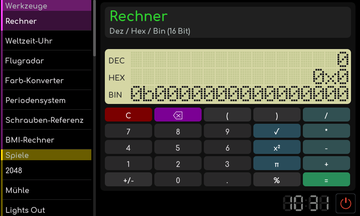](calculator.md) |
| [Weltzeit-Uhr](world-clock.md) |  |
| [Flugradar](flight-radar.md) | [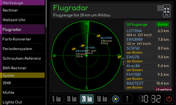](flight-radar.md) |
| [Farb-Konverter](color-converter.md) | [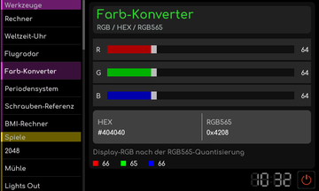](color-converter.md) |
| [Periodensystem](periodic-table.md) |  |
| [Schrauben-Referenz](screw-reference.md) |  |
| [BMI-Rechner](bmi-calculator.md) |  |

## Spiele

| Werkzeug | Vorschau |
| --- | --- |
| [2048](game-2048.md) |  |
| [Mühle](mill-game.md) | [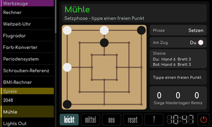](mill-game.md) |
| [Lights Out](lights-out.md) | [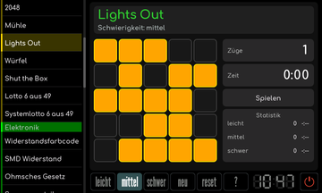](lights-out.md) |
| [Würfel](dice.md) | [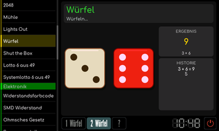](dice.md) |
| [Shut the Box](shut-the-box.md) | [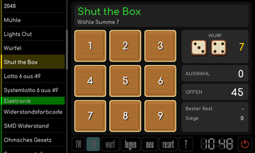](shut-the-box.md) |
| [Lotto 6 aus 49](lotto-normal.md) |  |
| [Lotto-System](lotto-system.md) |  |

## Elektronik

| Werkzeug | Vorschau |
| --- | --- |
| [Widerstandsfarbcode](resistor-color-code.md) |  |
| [SMD-Widerstandscode](smd-resistor-code.md) |  |
| [Ohmsches Gesetz](ohm-calculator.md) | [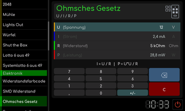](ohm-calculator.md) |
| [Spannungsteiler](voltage-divider.md) |  |
| [LED-Vorwiderstand](led-resistor-calculator.md) |  |
| [RC/RL-Filter](rc-rl-filter-calculator.md) |  |
| [LC-Filter](lc-filter-calculator.md) | [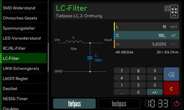](lc-filter-calculator.md) |
| [UKW-Schwingkreis](ukw-resonator.md) |  |
| [LM317-Regler](lm317-calculator.md) |  |
| [Dezibel](decibel-calculator.md) |  |
| [NE555-Timer](ne555-calculator.md) | [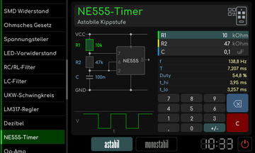](ne555-calculator.md) |
| [Op-Amp](opamp-calculator.md) |  |

## Einheiten

| Werkzeug | Vorschau |
| --- | --- |
| [Zoll und Millimeter](inch-mm-calculator.md) |  |
| [Temperatur](temp-calculator.md) | [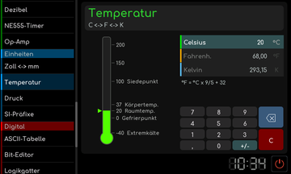](temp-calculator.md) |
| [Druck](pressure-calculator.md) | [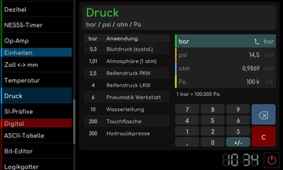](pressure-calculator.md) |
| [SI-Präfixe](si-prefixes.md) | [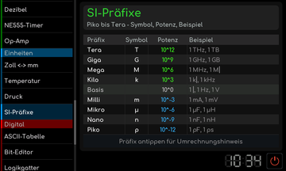](si-prefixes.md) |

## Digital

| Werkzeug | Vorschau |
| --- | --- |
| [ASCII-Tabelle](ascii-table.md) | [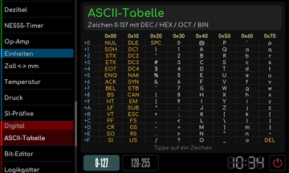](ascii-table.md) |
| [Bit-Editor](bit-editor.md) | [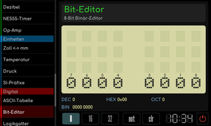](bit-editor.md) |
| [Logikgatter](logic-gate-sim.md) |  |

## Stricken

| Werkzeug | Vorschau |
| --- | --- |
| [Maschenprobe](stitch-gauge.md) | [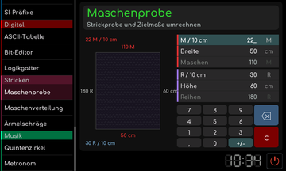](stitch-gauge.md) |
| [Maschenverteilung](stitch-distributor.md) |  |
| [Ärmelschräge](sleeve-taper.md) |  |

## Musik

| Werkzeug | Vorschau |
| --- | --- |
| [Quintenzirkel](circle-of-fifths.md) | [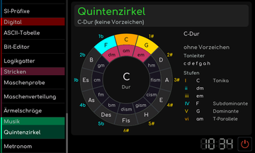](circle-of-fifths.md) |
| [Metronom](metronome.md) |  |

[Zur allgemeinen Bedienung](../Bedienung.md)

[RetroRadio](../../README.md) > [Dokumentation](../../README.md#dokumentation) > Werkstatt
