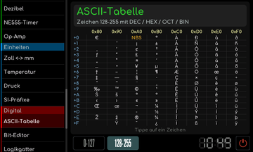
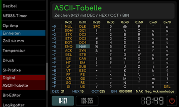

# ASCII-Tabelle

[RetroRadio](../../README.md) > [Dokumentation](../../README.md#dokumentation) > [Werkstatt](README.md) > [Digital](README.md#digital) > ASCII-Tabelle

Tippe ein Zeichen an. Die Detailanzeige zeigt seine Zahlenwerte in Dezimal-, Hexadezimal-, Oktal- und Binärdarstellung. Zwischen dem Grundbereich und dem erweiterten Bereich 128 bis 255 wechseln. Die erweiterten Zeichen gehören zur dargestellten Zeichentabelle und sind keine allgemeine Unicode-Liste.

**Erweiterte Zeichentabelle**

**Zeichendetails**

[RetroRadio](../../README.md) > [Dokumentation](../../README.md#dokumentation) > [Werkstatt](README.md) > [Digital](README.md#digital) > ASCII-Tabelle
