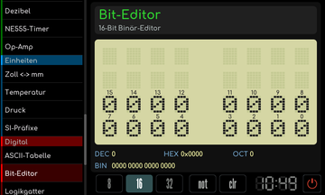
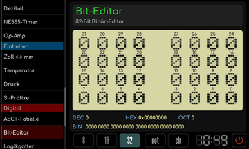
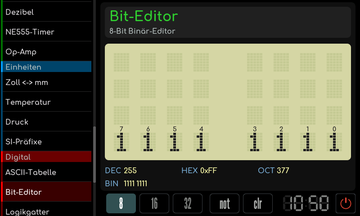

# Bit-Editor

[RetroRadio](../../README.md) > [Dokumentation](../../README.md#dokumentation) > [Werkstatt](README.md) > [Digital](README.md#digital) > Bit-Editor

Wähle 8, 16 oder 32 Bit. Tippe einzelne Bits an, um sie umzuschalten, und beobachte die zugehörigen Zahlendarstellungen. Das Werkzeug eignet sich zum Zusammensetzen und Prüfen von Bitmustern. Die gewählte Breite bestimmt, wie viele Bitpositionen angezeigt werden.

**16-Bit-Darstellung**

**32-Bit-Darstellung**

**Invertiertes Bitmuster**

[RetroRadio](../../README.md) > [Dokumentation](../../README.md#dokumentation) > [Werkstatt](README.md) > [Digital](README.md#digital) > Bit-Editor
