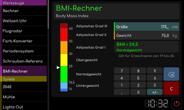

# BMI-Rechner

[Werkstattübersicht](README.md) | Kategorie: Werkzeuge

Tippe Größe oder Gewicht an und gib den Wert in Zentimetern beziehungsweise Kilogramm ein. Die Anzeige berechnet daraus den BMI und ordnet den Wert auf der eingeblendeten Skala ein. Die im Werkzeug genannte Altersgrenze beachten. Das Werkzeug dient der Berechnung und liefert keine persönliche medizinische Beurteilung.

