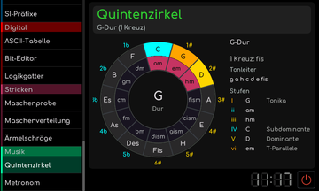

# Quintenzirkel

[RetroRadio](../../README.md) > [Dokumentation](../../README.md#dokumentation) > [Werkstatt](README.md) > [Musik](README.md#musik) > Quintenzirkel

Wähle eine Tonart am Kreis. Die Anzeige zeigt Vorzeichen, Tonleiter und Stufenharmonik der gewählten Dur-Tonart. Tonika, Subdominante, Dominante und Tonikaparallele sind zugeordnet. So lassen sich benachbarte Tonarten und ihre Vorzeichen vergleichen.

**G-Dur**

[RetroRadio](../../README.md) > [Dokumentation](../../README.md#dokumentation) > [Werkstatt](README.md) > [Musik](README.md#musik) > Quintenzirkel
