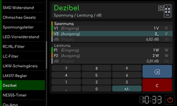

# Dezibel

[Werkstattübersicht](README.md) | Kategorie: Elektronik

Die beiden Bereiche rechnen Spannungs- und Leistungsverhältnisse getrennt. Gib die bekannten Eingangs-, Ausgangs- oder Pegelwerte in den passenden Bereich ein. Die Anzeige führt Verhältnis und dB-Wert zusammen. Spannungs- und Leistungsverhältnis verwenden unterschiedliche logarithmische Faktoren.

