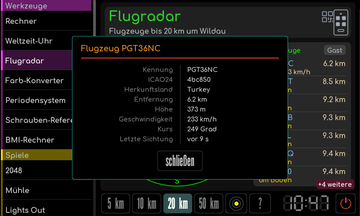
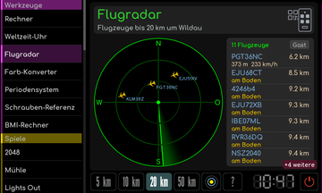
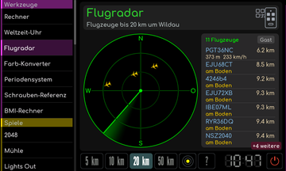

# Flugradar

[Werkstattübersicht](README.md) | Kategorie: Werkzeuge

Das Radar zeigt Flugzeuge im Umkreis des eingestellten Wetterstandorts. Unten den Suchradius wählen. Die Ringtaste wechselt zwischen Kennung mit Höhe und Tempo, nur Kennung und nur Symbol. Ein Tipp auf eine Zeile der Flugzeugliste öffnet die Details. Der Balken am rechten Rand zeigt die Zeit bis zum nächsten Abruf. Standort und OpenSky-Zugang werden in den [Dienste-Einstellungen](../dienste/Flugradar.md) eingerichtet.

**Flugzeugdetails**

**Nur Kennungen**

**Nur Flugzeugsymbole**

