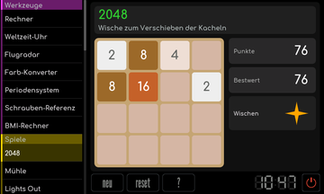

# 2048

[RetroRadio](../../README.md) > [Dokumentation](../../README.md#dokumentation) > [Werkstatt](README.md) > [Spiele](README.md#spiele) > 2048

Wische im Spielfeld nach oben, unten, links oder rechts. Alle Kacheln bewegen sich gemeinsam, gleiche Nachbarn verschmelzen zu ihrer Summe. Nach einem gültigen Zug erscheint eine neue Kachel. Ziel ist 2048. Neu beginnt eine weitere Partie, Reset betrifft den gespeicherten Bestwert und fragt vorher nach. Die Hilfe erklärt die Regeln am Gerät.

[RetroRadio](../../README.md) > [Dokumentation](../../README.md#dokumentation) > [Werkstatt](README.md) > [Spiele](README.md#spiele) > 2048
