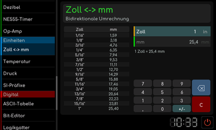

# Zoll und Millimeter

[Werkstattübersicht](README.md) | Kategorie: Einheiten

Tippe das Zoll- oder Millimeterfeld an und gib einen Wert ein. Der andere Wert wird mit 1 Zoll = 25,4 mm umgerechnet. Die Bruchauswahl hilft bei üblichen Zollmaßen. Beispiel: 1/2 Zoll entspricht 12,7 mm.

