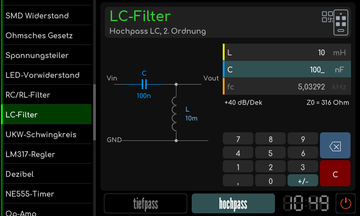

# LC-Filter

[RetroRadio](../../README.md) > [Dokumentation](../../README.md#dokumentation) > [Werkstatt](README.md) > [Elektronik](README.md#elektronik) > LC-Filter

Wähle tiefpass oder hochpass und gib Induktivität und Kapazität ein. Schaltskizze und Diagramm zeigen den gewählten Filter zweiter Ordnung. Die berechnete Frequenz ist eine Rechengröße der dargestellten Schaltung, reale Bauteilverluste und Belastungen werden damit nicht ausgemessen.

**Hochpass**

[RetroRadio](../../README.md) > [Dokumentation](../../README.md#dokumentation) > [Werkstatt](README.md) > [Elektronik](README.md#elektronik) > LC-Filter
