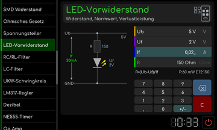

# LED-Vorwiderstand

[RetroRadio](../../README.md) > [Dokumentation](../../README.md#dokumentation) > [Werkstatt](README.md) > [Elektronik](README.md#elektronik) > LED-Vorwiderstand

Gib Versorgungsspannung, LED-Spannung und gewünschten Strom ein. Die Anzeige berechnet den Vorwiderstand, einen zugehörigen Normwert und die Verlustleistung. Die Schaltskizze zeigt die Reihenschaltung. Passe die Werte an die tatsächlich verwendete LED an.

[RetroRadio](../../README.md) > [Dokumentation](../../README.md#dokumentation) > [Werkstatt](README.md) > [Elektronik](README.md#elektronik) > LED-Vorwiderstand
