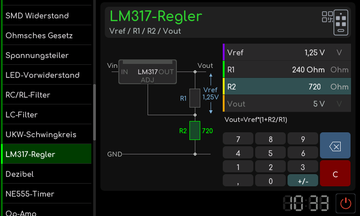

# LM317-Regler

[RetroRadio](../../README.md) > [Dokumentation](../../README.md#dokumentation) > [Werkstatt](README.md) > [Elektronik](README.md#elektronik) > LM317-Regler

Die Felder enthalten Referenzspannung, R1, R2 und Ausgangsspannung. Wähle den zu bearbeitenden Wert und seine Einheit. Die Skizze ordnet die Widerstände am Regler zu. Das Ergebnis beschreibt die Widerstandsbeschaltung und ersetzt keine Prüfung von Eingangsreserve, Verlustleistung und Kühlung der tatsächlichen Schaltung.

[RetroRadio](../../README.md) > [Dokumentation](../../README.md#dokumentation) > [Werkstatt](README.md) > [Elektronik](README.md#elektronik) > LM317-Regler
