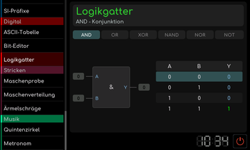
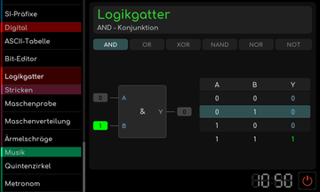
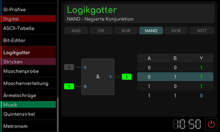
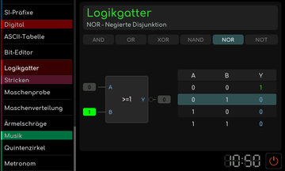
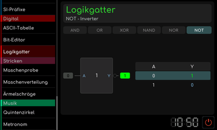
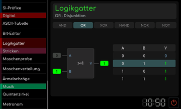
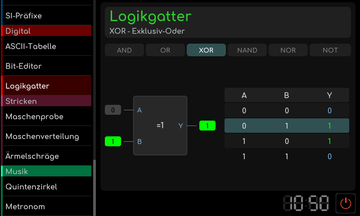

# Logikgatter

[Werkstattübersicht](README.md) | Kategorie: Digital

Wähle AND, OR, XOR, NAND, NOR oder NOT und schalte die Eingänge um. Das Gatterbild und der Ausgang zeigen das Ergebnis. Die Wahrheitstabelle ordnet die möglichen Eingangskombinationen zu. NOT besitzt nur einen Eingang.

**AND**

**NAND**

**NOR**

**NOT**

**OR**

**XOR**

