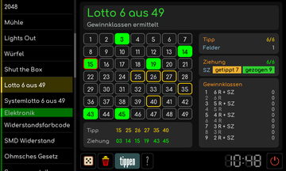

# Lotto 6 aus 49

[RetroRadio](../../README.md) > [Dokumentation](../../README.md#dokumentation) > [Werkstatt](README.md) > [Spiele](README.md#spiele) > Lotto 6 aus 49

Im Tippmodus sechs Zahlen und die Tipp-Superzahl auswählen. Der Würfel füllt den gewählten Bereich zufällig, die Mülltonne leert ihn. Mit ziehung zu den sechs gezogenen Zahlen und der gezogenen Superzahl wechseln. Die Tabelle vergleicht Tipp und Ziehung und zeigt die Gewinnklasse. Das Werkzeug ruft keine aktuellen Ziehungen ab und übermittelt keinen Spielschein.

[RetroRadio](../../README.md) > [Dokumentation](../../README.md#dokumentation) > [Werkstatt](README.md) > [Spiele](README.md#spiele) > Lotto 6 aus 49
