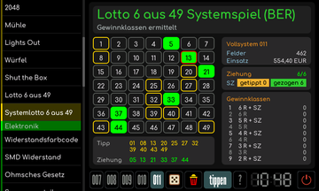

# Lotto-System

[Werkstattübersicht](README.md) | Kategorie: Spiele

Unten ein Vollsystem von 007 bis 011 wählen und die entsprechende Zahl von Tippzahlen markieren. Mit ziehung sechs Gewinnzahlen eintragen und die Superzahlen im rechten Bereich wählen. Würfel und Mülltonne wirken auf den jeweils ausgewählten Bereich. Die Tabelle zählt die Treffer je Gewinnklasse. Die angezeigten Einsatzangaben beziehen sich auf die im Werkzeug hinterlegten Werte für Berlin/Brandenburg; es erfolgt keine Spielabgabe.

