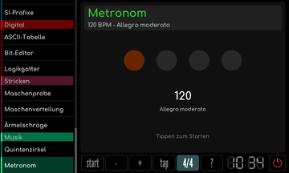
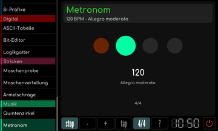
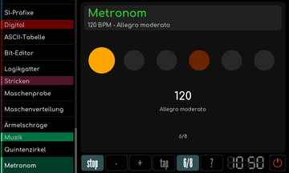

# Metronom

[Werkstattübersicht](README.md) | Kategorie: Musik

Mit - und + das Tempo ändern oder mit tap mehrfach im gewünschten Tempo tippen. Die Taktwahl wechselt zwischen 2/4, 3/4, 4/4 und 6/8. Start beziehungsweise Stop schaltet den Lauf um; auch ein Tipp auf die große Anzeige startet und stoppt. Die Punkte zeigen die Schläge, der erste Schlag ist hervorgehoben. In der Mitte stehen Tempo und italienische Tempobezeichnung.

**Laufendes Metronom**

**Taktart 6/8**

