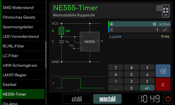

# NE555-Timer

[RetroRadio](../../README.md) > [Dokumentation](../../README.md#dokumentation) > [Werkstatt](README.md) > [Elektronik](README.md#elektronik) > NE555-Timer

Die Tasten astabil und monostabil wählen die Schaltung. Gib die im jeweiligen Modus gezeigten Widerstände und die Kapazität ein. Die Anzeige zeigt die berechneten Zeit- beziehungsweise Frequenzwerte zusammen mit Schaltskizze und Signalform.

**Monostabile Schaltung**

[RetroRadio](../../README.md) > [Dokumentation](../../README.md#dokumentation) > [Werkstatt](README.md) > [Elektronik](README.md#elektronik) > NE555-Timer
