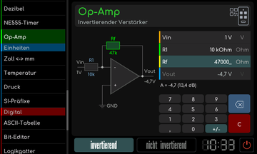
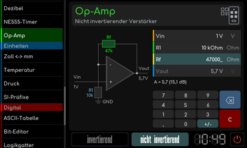

# Op-Amp

[Werkstattübersicht](README.md) | Kategorie: Elektronik

Wähle invertierend oder nicht invertierend. Bearbeite die Eingangs- und Rückkopplungswerte in den angezeigten Feldern. Schaltskizze und Ergebnis passen sich dem Modus an. Die Rechnung beschreibt die angezeigte ideale Verstärkerschaltung; tatsächliche Ausgangsgrenzen hängen vom eingesetzten Operationsverstärker und seiner Versorgung ab.

**Nicht invertierender Verstärker**

