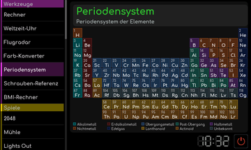
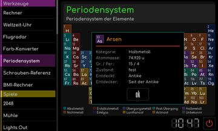

# Periodensystem

[Werkstattübersicht](README.md) | Kategorie: Werkzeuge

Die Übersicht ordnet die chemischen Elemente nach Gruppen und Perioden. Tippe ein Element an, um dessen Detailkarte mit Atommasse, Kategorie, Zustand und Angaben zur Entdeckung zu öffnen. Die Farben unterscheiden die Elementgruppen. Schließe die Detailkarte, um zur Tabelle zurückzukehren.

**Elementdetails**

