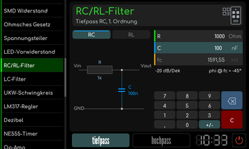
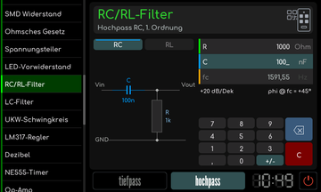
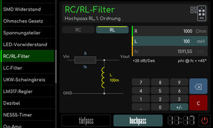
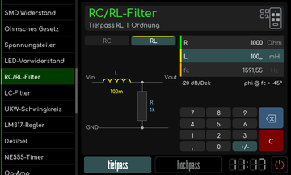

# RC/RL-Filter

[Werkstattübersicht](README.md) | Kategorie: Elektronik

Wähle RC oder RL sowie tiefpass oder hochpass. Gib die angezeigten Bauteilwerte ein. Das Werkzeug zeigt Grenzfrequenz, Schaltung und Frequenzgang eines Filters erster Ordnung. Bei einem Wechsel der Schaltung die Einheiten des Kondensators beziehungsweise der Spule beachten.

**RC-Hochpass**

**RL-Hochpass**

**RL-Tiefpass**

