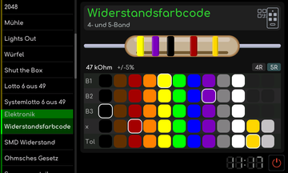

# Widerstandsfarbcode

[RetroRadio](../../README.md) > [Dokumentation](../../README.md#dokumentation) > [Werkstatt](README.md) > [Elektronik](README.md#elektronik) > Widerstandsfarbcode

Wähle die Darstellung mit vier oder fünf Farbringen und die Farben der Ringe. Das Werkzeug zeigt Widerstandswert und Toleranz. Bei vier Ringen stehen zwei Ziffern vor dem Multiplikator, bei fünf Ringen drei. Die Ausrichtung anhand des Toleranzrings beachten.

**Fünf Farbringe**

[RetroRadio](../../README.md) > [Dokumentation](../../README.md#dokumentation) > [Werkstatt](README.md) > [Elektronik](README.md#elektronik) > Widerstandsfarbcode
