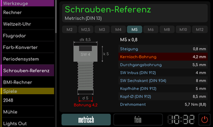
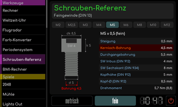

# Schrauben-Referenz

[Werkstattübersicht](README.md) | Kategorie: Werkzeuge

Wähle einen metrischen Gewindedurchmesser. Die Referenz zeigt Steigung, Kernloch- und Durchgangsbohrung sowie Kopf- und Schlüsselmaße. Die Tasten unten wechseln zwischen metrischem Regelgewinde und Feingewinde. Die angezeigten DIN-Bezüge und die jeweilige Schraubenart gehören zur Angabe; Werte nicht auf beliebige andere Schraubenköpfe übertragen.

**Feingewinde**

