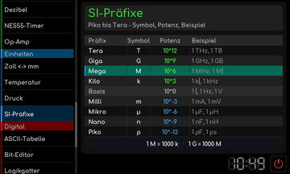

# SI-Präfixe

[RetroRadio](../../README.md) > [Dokumentation](../../README.md#dokumentation) > [Werkstatt](README.md) > [Einheiten](README.md#einheiten) > SI-Präfixe

Die Tabelle zeigt Vorsatz, Symbol, Zehnerpotenz und Beispiel. Tippe eine Zeile für den zugehörigen Umrechnungshinweis an. Die im Werkzeug enthaltene Auswahl reicht von Tera bis Piko. Groß- und Kleinschreibung der Symbole unterscheiden, etwa M für Mega und m für Milli.

**Umrechnungshinweis**

[RetroRadio](../../README.md) > [Dokumentation](../../README.md#dokumentation) > [Werkstatt](README.md) > [Einheiten](README.md#einheiten) > SI-Präfixe
