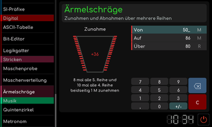

# Ärmelschräge

[RetroRadio](../../README.md) > [Dokumentation](../../README.md#dokumentation) > [Werkstatt](README.md) > [Stricken](README.md#stricken) > Ärmelschräge

Gib Anfangs- und Endmaschenzahl sowie die Zahl der Reihen ein. Das Werkzeug verteilt beidseitige Zu- oder Abnahmen über die Reihen. Da beide Seiten gemeinsam verändert werden, muss die Maschendifferenz gerade sein. Die Anzeige nennt die Wiederholungen und Reihenabstände, unpassende Eingaben werden erläutert.

[RetroRadio](../../README.md) > [Dokumentation](../../README.md#dokumentation) > [Werkstatt](README.md) > [Stricken](README.md#stricken) > Ärmelschräge
