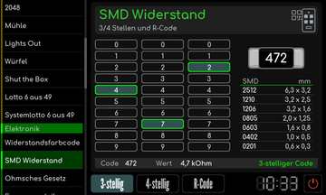
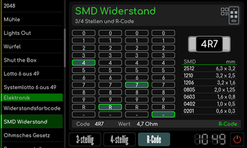
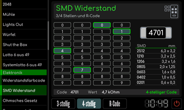

# SMD-Widerstandscode

[RetroRadio](../../README.md) > [Dokumentation](../../README.md#dokumentation) > [Werkstatt](README.md) > [Elektronik](README.md#elektronik) > SMD-Widerstandscode

Wähle die passende Codierungsart und gib den Aufdruck des SMD-Widerstands ein. Das Werkzeug unterstützt drei- und vierstellige Zifferncodes sowie die R-Notation. EIA-96 wird nicht ausgewertet. Die Ergebnisanzeige zeigt den Widerstandswert, R kennzeichnet bei entsprechenden Codes die Dezimalstelle. Die Null-Ohm-Brücke wird gesondert angezeigt.

**R-Notation**

**Vierstelliger Aufdruck**

[RetroRadio](../../README.md) > [Dokumentation](../../README.md#dokumentation) > [Werkstatt](README.md) > [Elektronik](README.md#elektronik) > SMD-Widerstandscode
