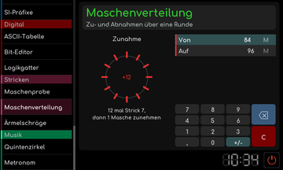

# Maschenverteilung

[Werkstattübersicht](README.md) | Kategorie: Stricken

Trage die bisherige Maschenzahl unter Von und die gewünschte Zahl unter Auf ein. Das Werkzeug verteilt Zu- oder Abnahmen auf eine Runde und formuliert die einzelnen Strickabschnitte. Bei gleichen Werten wird keine Änderung benötigt; eine für eine Runde zu große Differenz wird angezeigt.

