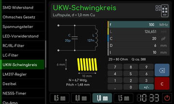
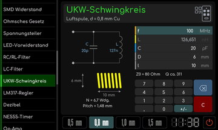
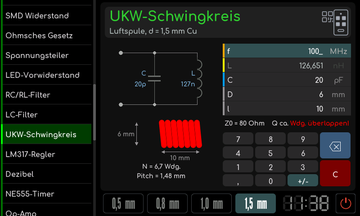

# UKW-Schwingkreis

[Werkstattübersicht](README.md) | Kategorie: Elektronik

Gib die im Werkzeug angebotenen Spulen- und Kondensatorwerte ein und wähle den Drahtdurchmesser. Die Anzeige berechnet den Schwingkreis und zeigt eine Skizze der Luftspule. Warnungen zu überlappenden Windungen oder Werten außerhalb des Bereichs beachten. Die angezeigte Güte ist als Näherung gekennzeichnet.

**Drahtdurchmesser 0,8 mm**

**Drahtdurchmesser 1,0 mm**

**Drahtdurchmesser 1,5 mm mit Überlappungswarnung**

