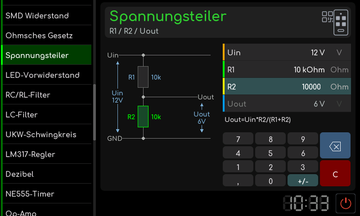

# Spannungsteiler

[Werkstattübersicht](README.md) | Kategorie: Elektronik

Gib die bekannten Werte des Spannungsteilers in die zugehörigen Felder ein und beachte die Einheitenauswahl. Die Schaltskizze ordnet R1, R2 sowie Ein- und Ausgangsspannung zu. Die Berechnung beschreibt den angezeigten Widerstandsteiler; eine angeschlossene Last ist bei der tatsächlichen Schaltung zusätzlich zu berücksichtigen.

