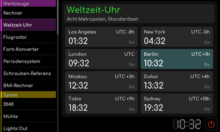

# Weltzeit-Uhr

[RetroRadio](../../README.md) > [Dokumentation](../../README.md#dokumentation) > [Werkstatt](README.md) > [Werkzeuge](README.md#werkzeuge) > Weltzeit-Uhr

Die Übersicht zeigt acht Städte von Los Angeles bis Sydney. Grundlage ist die am Radio eingestellte Zeit. Die Anzeige verwendet die im Werkzeug hinterlegten Standardzeit-Abstände, die Bezeichnung Standardzeit im Titel beachten. Prüfe für zeitkritische Absprachen zusätzlich die jeweils geltende Ortszeit.

[RetroRadio](../../README.md) > [Dokumentation](../../README.md#dokumentation) > [Werkstatt](README.md) > [Werkzeuge](README.md#werkzeuge) > Weltzeit-Uhr
